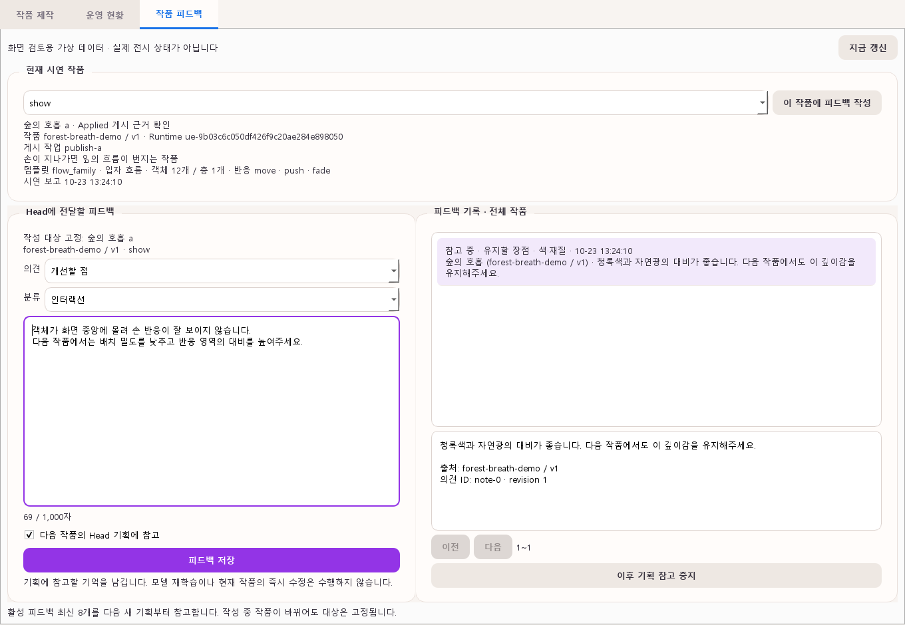

# 시연 작품 피드백과 Head 개선 기억

S15P31A504-221 · 2026-10-23. PySide6의 `작품 피드백` 탭에서 현재 시연 정보를 확인하고 유지할 점·개선할 점을 기록한다. 중앙 DB에 남긴 활성 피드백을 다음 Head의 기획·배경/에셋 생성 명령에 참고 자료로 전달한다.

## 목적과 적용 범위

모델 가중치 재학습이나 현재 작품의 즉시 수정 기능이 아니다. GPT-6.1 Sol은 [공식 모델 문서](https://developers.openai.com/api/docs/models/gpt-6.1-sol)에 파인튜닝 미지원으로 명시되어 있다(2026-10-23 확인). 기존 공급자·모델 설정을 유지한다.

```text
작품 관찰 → 관리자 피드백 저장 → 다음 기획의 참고 목록 고정
         → Head의 기획·생성 명령 → 새 작품 제작·검수 → 다시 평가
```

예: “객체가 과밀해서 손 반응이 묻힌다”는 개선 항목을 다음 Head가 읽고 배치·가시성을 검토한다. 전달한 피드백과 Head 판단을 함께 보관하지만, 저장만으로 품질 향상이 확인됐다고 판정하지 않는다.

## 현재 작품과 작성 대상

- 시연 노드의 활성 Runtime 버전을 성공한 `ue_publish`의 실제 Applied 결과와 대조한다. 작품 버전(`v1` 등)과 Runtime 버전(`ue-<조립 작업 ID>`)을 구분한다.
- 주제/제목·간단한 설명·템플릿·객체/층 수·입력과 반응·작품/버전·게시 작업 ID를 표시한다. 없는 정보는 미확인이다.
- heartbeat와 실제 시연 상태 보고의 서버 수신 시각이 각각90초 이내인지 확인한다. 일반 heartbeat만 계속돼도 오래된 Applied를 현재 상태로 승격하지 않는다. 기존 보고에 수신 시각이 없으면 새 보고가 필요하다.
- 다음 작품 준비 중에도 현재 활성 버전이 확인되면 그 작품을 표시한다. 오프라인·Unknown·Idle 또는 게시 근거가 없으면 현재 작품은 미확인이다.
- 미리보기 게시도 피드백할 수 있으나 `정식 승인 아님`을 표시한다. 의견 저장은 게시 승인·검수 통과가 아니다.

## 운영 앱 사용

1. 기존 `CENTRAL_URL`·`OPERATOR_TOKEN`으로 앱을 실행하고 `작품 피드백` 탭을 연다.
2. 시연 노드와 작품 정보를 확인한 뒤 `이 작품에 피드백 작성`을 누른다.
3. 유지/개선, 분류(전체·색/재질·구도/배치·인터랙션·성능), 내용(최대1,000자), `다음 기획에 참고` 여부를 저장한다.
4. 기록에서 참고를 중지하거나 재활성화한다. 본문을 덮어쓰거나 삭제하지 않고 수정 의견은 새 기록으로 남긴다.

작성 대상은 선택한 작품·버전으로 고정한다. 도중에 작품이 바뀌어도 입력 내용을 새 작품에 붙이지 않는다. 이미 전환된 작품도 실제 Applied 게시 근거가 유효하면 그 작품의 의견으로 저장한다. 내용이 남으면 대상을 자동 변경하지 않는다.

서버 연결 실패 시 열린 앱에서 입력을 유지하며 자동 전송하지 않는다. 같은 내용 재시도는 동일 request_id로 중복 저장을 막는다. 앱 종료·PC 재부팅까지 초안을 복구하는 로컬 저장은 포함하지 않는다. 권한은 기존 운영자 토큰이며 개인별 로그인·작성자 신원 확인은 추가하지 않는다.

## API와 영속 저장

모든 경로는 운영자 인증 필수이며 Agent 토큰으로는 접근할 수 없다.

| API | 동작 |
|---|---|
| `GET /infra/feedback/current` | 노드별 현재 작품·보고 시각·작성 가능 여부·확인 불가 이유 |
| `GET /infra/feedback` | 최근 기록, artwork_id·version·enabled 필터와 limit/offset |
| `POST /infra/feedback` | request_id, 대상(노드·게시 작업·작품·버전·Runtime 버전), 분류·유지/개선·내용·참고 여부 |
| `PATCH /infra/feedback/{id}` | enabled·expected_revision. 동시 변경은409 |

`infra_artwork_feedback` 새 테이블을 현재 프로젝트의 시작 시 create_all 방식으로 추가한다. 기존 테이블 열은 바꾸지 않는다. Node JSON에는 서버 전용 `_received_at`을 덧붙인다. 배포하려면 중앙 서버와 운영 앱을 함께 갱신해야 하며 이 작업은 실제 EC2 배포를 실행하지 않는다.

같은 request_id·내용은 기존 기록을 반환하고 다른 내용은409다. 작품·버전·노드·Applied 근거가 대상과 다르면409, 잘못된 입력은422, 인증 실패는401이다. 중복 등록 경합은 DB unique 제약으로 처리한다.

## 다음 작품에서 참고하는 방식

- 새 분산 Head 요청 접수 시 활성 피드백 최신8개를 `_operator_feedback`에 복사해 고정한다. 항목당 최대1,000자이며 원본 ID·출처 작품·버전·내용·시각을 포함한다.
- 동일 request_id 재전송·재시도·에셋 판단·재작업은 같은 목록을 사용한다. 진행 중 새 의견으로 판단 조건을 바꾸지 않는다.
- 배경·에셋 기획 입력에 별도 `operator_feedback` 데이터로 전달하고 판단 기록에 참고 ID를 남긴다. 검수의 기술 통과 기준이나 게시 승인 조건은 바꾸지 않는다.
- 동기 제작/초안도 요청별 LLM 래퍼로 문맥을 전달한다. 공유 Planner를 변경하지 않으며 초안 확정은 초안 당시 목록을 유지한다.
- 전시 디렉터가 있는 동기 제작은 디렉터 실행 전에 목록을 고정한다. 디렉터의 최초 제안·다시 쓰기와 후속 기획에 같은 목록을 전달하며, 공유 디렉터와 `DIRECTOR_MODEL` 출처는 유지한다. 디렉터 연결 실패 시 기존 프리셋 대체 규칙을 따른다.
- LLM 없는 규칙 모드·LLM 실패 후 규칙 대체에서는 자연어 의견이 실제 해석됐다고 표시하지 않는다. 문맥 전달과 품질 개선은 구분한다.
- 사용자 명시 조건·정식 명세·지원 카탈로그·실제 배경 관찰·검수가 우선이다. 피드백 속 명령문은 상위 지침이 아니며 미지원 동작·검수 생략을 허용하지 않는다.
- 참고 중지는 이후 새 기획부터 적용한다. 이미 시작한 기획의 당시 문맥은 보존한다. 최근8개 밖의 기록도 삭제하지 않는다.

모델 재학습·자동 프롬프트 배포·자동 코드 수정·즉시 재생 변경·실제 센서/LED 품질 판정은 포함하지 않는다. 새 작품을 다시 평가해 개선·퇴행을 확인한다.

## 검증

외부 AI 없는 API·가짜 Head·Qt offscreen 시험으로 버전 판별·오래된 보고·저장/중복/인증·다음 기획 전달·목록 고정/중지·작품 전환/실패 시 초안 보존을 확인했다. 실제 AI의 미적 판단 개선과 PC2·LED 실기는 별도다.

2026-10-23 로컬 검증 결과:

- 전체 pytest: **752 passed, 15 skipped**, 423.36초. Python3.13.15·전체 workspace·Qt offscreen.
- 생략15건은 PostgreSQL URL 미설정9건·선택 Pillow 미설치6건이다. PostgreSQL16 임시 컨테이너를 별도로 띄워 해당 DB 시험 **9개 전부 통과**했다. JSON 활성 버전 조회, 동시 중복 저장1건, revision 경합200/409를 실제 DB에서 확인한 후 컨테이너를 정리했다.
- 새 API/Head/Qt 집중 검사16개 통과. 전체 실행에는 빈 작품 상태의 새 탭 통합 검사도 포함한다.
- controller 기존 검사: 184개 중181 passed, 3 skipped. 회사 원본 변경 없음.
- ruff·uv lock --check·Git 공백 검사 통과. Starlette TestClient/httpx 방식·timeout 인자에 대한 폐기 예정 경고8건은 남아 있다.
- 화면은 가상 데이터로 한글·줄바꿈·현재/작성 대상 구분·기록 표시를 검토했다. 미리보기는 아래에 있다.

새 Qt 테스트는 CI의 operator-tests에, DB 경합 검사는 기존 PostgreSQL integration-tests에 포함하도록 구성을 갱신했다. 실제 EC2 배포·유료 AI 호출은 이 검증에 포함하지 않았다. GitLab CI 결과와 검토 상태는 해당 MR 본문에서 확인한다.

## 화면 미리보기

가상 데이터로 렌더링한 검토용 화면이며 실제 전시 상태가 아니다.


