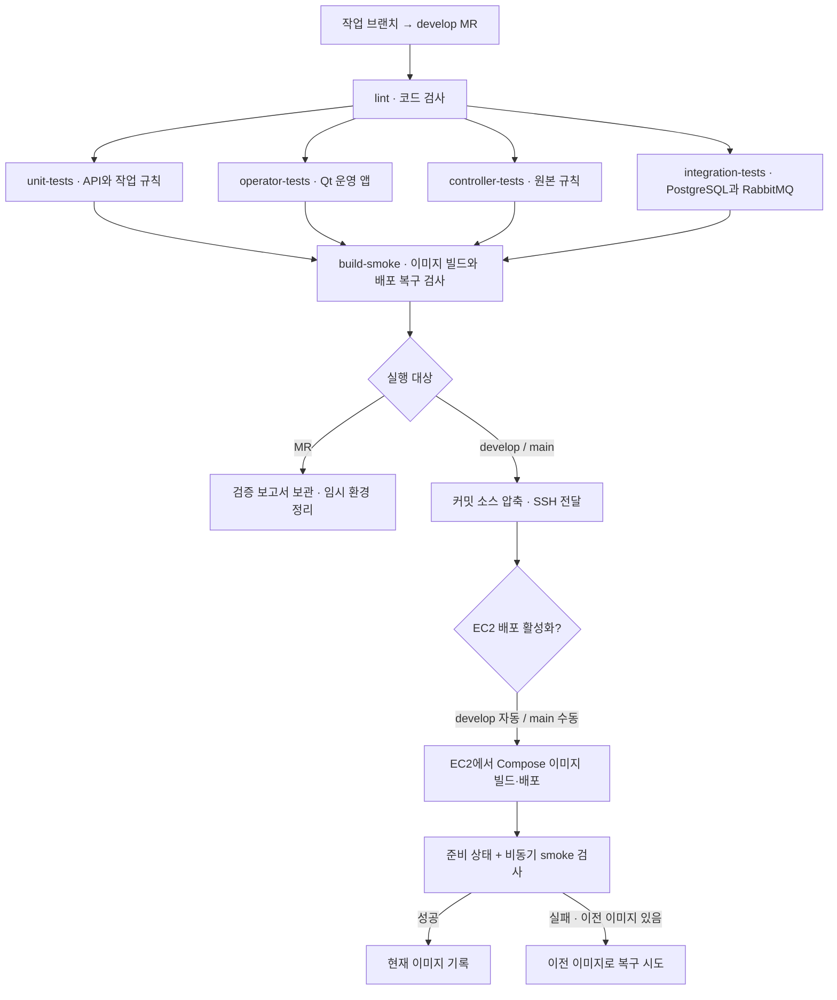

# CI/CD 파이프라인

현재 GitLab은 변경된 코드를 검사하고, 네 종류의 테스트를 병렬 실행한 뒤 중앙 서버 이미지를 빌드합니다.
빌드한 이미지를 임시 Docker 환경에서 실행하고 배포 실패 시 이전 이미지로 복구되는지까지 검사합니다.
작업은 노트북의 Docker Runner가 실행하며 최대 4개까지 동시에 받을 수 있습니다.
2026-10-22부터 develop의 EC2 테스트 자동 배포를 활성화했습니다. 운영은 main 릴리스 반영 후 수동 배포합니다.
팀원 PC의 실제 접속·기능 확인은 [테스트·운영 접속 안내](ENVIRONMENT_ACCESS.md)를 따릅니다.

기준은 [`.gitlab-ci.yml`](../.gitlab-ci.yml)입니다. 이 문서는 파이프라인의 동작을 설명하고,
실제 실행 결과는 [인프라 검증 기록](../infra/VALIDATION.md)에 별도로 남깁니다.

## 전체 흐름

CI는 코드의 변경을 검사하는 절차입니다. 작품 기획→배경→에셋→UE 조립→전시 교체를 실행하는
작품 제작 파이프라인과는 별개입니다. CI에서 실제 외부 AI 생성이나 UE 전시를 실행하지 않습니다.

## 실행 조건

| 이벤트 | 실행되는 작업 | 서버 변경 여부 |
|---|---|---|
| MR 생성·MR 브랜치에 추가 push | `lint` → 네 테스트 → `build-smoke` | 임시 환경만 사용 |
| 보호된 `develop` 변경 | `lint` → 네 테스트 → `build-smoke` → `deploy_staging` | 분리된 테스트 환경 자동 갱신 (활성화 완료) |
| `main` 변경 | 동일 검사 수행 | 배포 job을 수동 실행하기 전에는 서버 변경 없음 |
| 보호된 `main` + `EC2_DEPLOY_ENABLED=true` | 위 작업 성공 후 `deploy_ec2` 수동 실행 가능 | 실행하면 운영 중앙 서비스 교체 |
| MR 없는 일반 작업 브랜치 push | 파이프라인 생성 안 함 | 없음 |

`workflow.rules`가 파이프라인 생성 여부를 결정합니다. MR은 소스 브랜치 내용으로 검사하므로
최신 develop 통합 후에도 확인해야 합니다. 앞 단계가 실패하면 다음 단계로 진행하지 않습니다.
GitLab의 파이프라인 성공과 MR의 병합 가능 여부·승인 규칙은 별도 설정입니다.

## 각 작업에서 하는 일

### 1. lint — 코드와 설정 검사

Python 3.12와 uv가 포함된 이미지를 digest로 고정해 사용합니다.
`uv sync --locked`로 잠금 파일의 의존성을 설치한 후 다음을 검사합니다.

- `ruff check .`: Python 코드의 오류와 스타일 규칙.
- `uv lock --check`: 프로젝트 의존성 선언과 `uv.lock`의 일치 여부.
- `bash -n`: EC2의 사전 점검·배포 스크립트 구문.

### 2. 네 테스트 작업 — 실패 영역을 구분하고 병렬 실행

`unit-tests`, `operator-tests`, `controller-tests`, `integration-tests`는 같은 test 단계에서
최대 4개까지 동시에 실행됩니다. 각 작업의 JUnit 보고서가 GitLab Tests 화면에 표시됩니다.
DB와 큐가 필요한 `integration-tests`에만 임시 PostgreSQL 16과 RabbitMQ 4.2를 붙입니다.
운영 DB·브로커·비밀번호를 사용하지 않습니다.

| 검사 | 확인하는 내용 |
|---|---|
| `unit-tests` | 기본 pytest 수집에서 운영 앱·PostgreSQL 전용 파일만 제외. API·계약·상태 전이·Agent·파일 전달과 새 일반 테스트를 자동 수집 |
| `operator-tests` | 전체 workspace와 Qt를 설치하고 `test_operator.py`·`test_operator_monitor.py`·`test_operator_feedback.py` 실행. Qt import를 먼저 확인해 미설치를 성공으로 오인하지 않음 |
| `controller-tests` | pytest로 기존 unittest를 수집하여 JUnit 생성. `ART_RUNTIME_ROOT`가 필요한 검사는 자료가 없으면 생략 |
| `integration-tests` | 실제 PostgreSQL 작업 임대·피드백 동시성/활성 버전 조회와 Head 자동 게시·수동 승인 흐름을 검사한 뒤 `infra/check_pipeline.py`로 API·Celery Worker·Dispatcher를 DB/큐에 연결 |
| 위 스크립트의 smoke | 진단·초안 완료, Worker 중단 중 접수한 작업의 재시작 후 완료 |
| 생성 작업 smoke | 배경→에셋 의존성과 테스트 파일의 해시·결과 전달 |

Qt는 `QT_QPA_PLATFORM=offscreen`으로 실행합니다. 화면 창을 열지 않고 운영 앱의 로직을 검사합니다.
생성 검사는 테스트 파일을 사용하며 실제 Codex·이미지 공급자·UE 성능 검증을 대신하지 않습니다.
pytest 결과는 `runtime/junit-*.xml`로 생성되어 GitLab의 **Tests** 화면에 올라갑니다.
job 실패 시에도 JUnit 파일이 만들어졌다면 업로드합니다.

### 3. build-smoke — 실제 이미지 기동·교체·실패 복구

작업 전용 rootless Docker의 BuildKit이 [`infra/central/Dockerfile`](../infra/central/Dockerfile)의 `runtime` 대상을 빌드합니다.
이미지는 FastAPI·Celery Worker·Dispatcher가 공통으로 사용하며 PySide6 운영 앱과 UE는 포함하지 않습니다.
중앙 서비스는 이미지 내부에서 일반 사용자 UID 10001로 실행합니다.

- 빌드와 기동 검사는 같은 job에서 같은 이미지 ID를 사용합니다. 큰 이미지 tar를 GitLab artifact로 전달하거나 재빌드하지 않습니다.
- MR·develop에서는 이미지와 임시 DB/큐/볼륨을 작업 종료 때 정리하고 검증 보고서·진단 로그만 7일간 보관합니다.
- Registry에는 게시하지 않습니다. 배포 job이 같은 커밋의 추적 소스를 SSH로 전달합니다.
  EC2는 `infra/central/Dockerfile`로 다시 빌드하고 설치된 리소스와 비동기 완료를 검사합니다.
  같은 커밋이어도 기반 이미지·캐시 영향으로 CI와 EC2의 이미지 ID가 같다고 보장하지 않습니다.

[`infra/ci_deploy_test.py`](../infra/ci_deploy_test.py)는 실제 EC2에서 사용할 `deploy.sh`를 그대로 호출합니다.
임시 경로·프로젝트 이름·Compose 덮어쓰기 설정만 전달하며 현재 노트북 서버와 연결하지 않습니다.

1. 정상 기준 이미지를 배포하고 API→RabbitMQ→Worker→PostgreSQL 작업 완료를 확인합니다.
2. DB 표식과 `/data` 파일을 만든 뒤 후보 이미지로 교체하고, 세 프로세스의 실제 이미지 ID와 데이터 보존을 확인합니다.
3. 시작하자마자 종료되는 이미지로 배포를 실패시킵니다. 배포 명령의 실패 반환과 이전 정상 이미지 복구를 모두 확인합니다.
4. API는 실행되지만 Worker가 처리하지 않는 이미지로 비동기 검사를 실패시켜 같은 복구 경로를 확인합니다.
5. 실패한 이미지가 `current-image`에 기록되지 않았는지, 인증 설정·DB·파일이 유지되는지 확인하고 임시 환경을 정리합니다.
6. 소스에서 다시 빌드하는 배포 경로를 실행하고 DB·파일이 유지되는지 확인합니다.
7. Compose 구성 자체가 깨진 릴리스를 배포해 직전 Compose와 이미지로 복구하는지 확인합니다.

정상 기준 이미지는 후보와 같은 앱 코드에 다른 테스트 표식을 넣어 **다른 이미지 ID**로 만듭니다.
이 검사는 이미지 교체와 복구 동작을 확인하며 과거 릴리스의 DB 스키마 호환성까지 보증하지 않습니다.
결과는 `runtime/ci-deploy/junit.xml`, `result.json`, 단계별 로그에 남습니다. 비밀 값·환경 파일은 artifact에 넣지 않습니다.
`resource_group: ranel-ci-deploy-smoke`로 이 무거운 검사는 프로젝트에서 하나씩 실행합니다.

### 4. EC2 소스 배포 — develop 테스트 · main 운영

`EC2_DEPLOY_ENABLED=true`와 보호된 브랜치가 필요합니다. `develop`은 `deploy_staging`을 자동 실행하고,
`main`은 `deploy_ec2`를 운영자가 수동 실행합니다. MR에는 배포 job을 만들지 않습니다.

[`ci_deploy.sh`](../infra/central/ci_deploy.sh)가 Git 추적 소스의 압축·SHA-256을 전달하고,
서버의 [`receive_source.py`](../infra/central/receive_source.py)가 경로·링크·비밀 파일·덮어쓰기를 검사합니다.
테스트는 `/opt/ranel-staging/releases/<SHA>`, 운영은 `/opt/ranel/releases/<SHA>`를 사용합니다.
프로젝트·DB·큐·파일·CA·토큰이 독립적이며 운영 기록을 테스트 환경에 복사하지 않습니다.

1. Compose 설정을 검사하고 EC2에서 `infra/central/Dockerfile`로 SHA 태그 이미지를 빌드합니다.
2. 중앙 API·Worker·Dispatcher를 갱신하고 서비스 준비 상태를 기다립니다.
3. 중앙 컨테이너 내부에서 실제 API→RabbitMQ→Worker→PostgreSQL 비동기 smoke 검사를 실행합니다.
4. 성공하면 `/opt/ranel/current-image`를 새 SHA 이미지로 갱신합니다.
5. 실패하면 이전 이미지와 Compose 경로로 복구를 시도하고 배포 job을 실패로 끝냅니다.

GitLab `resource_group: ranel-ec2`와 서버의 파일 잠금으로 겹치는 배포를 막습니다.
배포 job은 `interruptible: false`입니다. 데이터 볼륨은 유지하지만 DB 스키마를 되돌리는 기능은 없으며,
현재 절차를 무중단 배포로 보장하지 않습니다. 첫 배포는 이전 이미지가 없어 자동 복구할 수 없습니다.

`deploy.sh`의 기본 경로는 `/opt/ranel`, Compose 프로젝트는 `ranel`, 기동 대기는 180초,
비동기 작업별 대기는 90초입니다. CI에서만 `RANEL_DEPLOY_ROOT`, `RANEL_COMPOSE_PROJECT`,
`RANEL_COMPOSE_OVERRIDE`, `RANEL_DEPLOY_WAIT_TIMEOUT`, `RANEL_DEPLOY_SMOKE_TIMEOUT`을 바꿉니다.
소스 배포는 `RANEL_DEPLOY_BUILD=1`, `RANEL_DEPLOY_PULL_POLICY=never`를 사용합니다.
기존 이미지 검증 경로는 유지하며 CI에서 임시 프로젝트·테스트 Compose를 지정합니다.
CI용 `compose.ci.yaml`은 호스트 포트와 PostgreSQL 초기화 파일 마운트를 제거하므로 운영에 적용하지 않습니다.

## 노트북 Runner와 동시 실행 4개

등록된 Runner는 [#2191 `ranel-laptop-linux-docker`](https://lab.ssafy.com/s15-final/S15P31A504/-/runners/2191)입니다.
프로젝트에 잠겨 있으며 `linux-docker` 태그의 작업만 받습니다.

| 설정 | 값과 의미 |
|---|---|
| 실행 방식 | Docker Desktop Linux 엔진의 Docker executor |
| 전역 `concurrent` / Runner `limit` | 모두 4. 노트북 전체에서 CI job 최대 4개 |
| `request_concurrency` | 4. GitLab에 작업을 요청하는 동시 요청 수 |
| job 제한 | CPU 2개, 메모리 2 GiB |
| 부속 service 제한 | 각각 CPU 2개, 메모리 2 GiB; job당 최대 2개. 임시 Docker 안의 전체 테스트 스택도 이 상한을 공유 |
| job 시간 제한 | 30분 |
| 작업 격리 | job별 네트워크·임시 DB/브로커. 작업 컨테이너에 호스트 폴더·Docker socket·중앙 데이터 볼륨 미연결 |
| 이미지 검증 권한 | 일반 job은 비특권. 고정된 공식 rootless DinD 서비스 한 종류만 privileged 허용. 작업별 TLS 연결·임시 DB와 볼륨 사용 |
| 관리자 컨테이너 | 컨테이너 생성을 위해 Docker socket 사용. 프로젝트 CI 코드 변경은 검토 필요 |

**4개는 동시에 실행 가능한 CI job 수**입니다. 작품 생성 노드 수나 Celery 동시성 설정이 아닙니다.
한 파이프라인에서도 lint 이후 네 테스트 job이 동시에 실행될 수 있습니다.
서로 다른 MR도 이 4개 슬롯을 공유하며 모든 테스트 성공 후 이미지 기동·복구 검사를 실행합니다.

노트북이 꺼지거나 절전 상태이거나 Docker Desktop이 중지되면 작업이 대기합니다.
실행·중지 명령과 인증 토큰 보관 위치는 [Runner 운영 안내](../infra/runner/README.md)에 있습니다.
토큰·개인키·운영 `.env`를 GitLab 저장소나 CI 로그에 넣지 않습니다.

## EC2 연결 설정

| 항목 | 준비 내용 |
|---|---|
| EC2 기본 환경 | Linux·Docker/Compose·Python 3·배포 계정, `/opt/ranel` 쓰기 권한 |
| `SSH_PRIVATE_KEY` | 배포 전용 SSH 개인키. GitLab **File**, protected, 환경 범위 `ec2/*` |
| `SSH_KNOWN_HOSTS` | 별도 확인한 EC2 SSH 호스트 키. GitLab **File**, protected, 환경 범위 `ec2/*` |
| `EC2_USER`, `EC2_HOST` | CI 기본 ubuntu·k15a504.p.ssafy.io. 필요 시 변경 |
| `EC2_DEPLOY_ENABLED` | 준비 완료 후 protected 변수 `true`로 활성화 |
| Registry | 사용하지 않음. 소스 전달 후 EC2에서 빌드 |
| 서버 설정 | `.env.infra`, 네트워크·TLS·접근 제어, 백업·복원 준비 |

protected 변수를 쓰기 위해 main·develop 보호 설정도 확인합니다. SSH 호스트 키 확인을 끄지 않습니다.
노트북 중앙은 EC2로 이전했으며 Runner는 노트북에 유지합니다.
Runner가 노트북에 있어도 SSH로 EC2에 배포할 수 있습니다.
구체적인 이관 순서는 [운영 준비](../infra/OPERATIONS.md)와 [노트북 중앙 서버 안내](../infra/LAPTOP_SERVER.md)를 따릅니다.

## 팀에서 결과를 확인하는 방법

1. 작업 브랜치를 push하고 develop 대상 MR을 엽니다. MR 템플릿 체크박스는 모두 남깁니다.
2. MR의 Pipelines 또는 프로젝트 Build → Pipelines에서 각 job 상태를 확인합니다.
3. 실패하면 해당 job 로그의 첫 오류를 확인합니다. pytest 결과는 Tests에서 확인합니다.
4. 원인을 수정하고 같은 MR 브랜치에 push하면 새 파이프라인이 생성됩니다.
5. CI 통과와 검토를 마친 뒤 저장소의 병합 규칙을 따릅니다. MR 생성만으로 병합·배포되지 않습니다.

| 증상 | 먼저 확인할 내용 |
|---|---|
| Pending 상태 유지 | 노트북/Docker 실행, Runner Online·Pause 상태, `linux-docker` 태그, 현재 4개 실행 여부 |
| lint 실패 | Ruff 오류 위치, `uv.lock`, Bash 구문 |
| test 서비스 연결 실패 | 해당 job의 임시 PostgreSQL·RabbitMQ 준비 상태와 자원 제한 |
| build-smoke 시작 실패 | 고정 rootless DinD 서비스 허용·TLS 인증서 볼륨·Runner 자원 제한 |
| 이미지 기동·복구 검사 실패 | job artifact의 단계별 로그·`result.json`·JUnit. 의도한 장애 뒤 이전 이미지 ID/데이터/비동기 완료까지 확인 |
| EC2 배포 job 없음 | main/develop 여부, 배포 활성화 변수, 보호 브랜치·변수 환경 범위 |
| EC2 배포 실패 | SSH·호스트 키·소스 검증·EC2 빌드·Compose readiness·비동기 smoke와 복구 로그 |

현재 구현 밖의 항목은 Windows 앱 설치본 빌드, UE 빌드·쿠킹, 작품 승인·전시 교체 자동화,
운영 로그 수집 플랫폼입니다. 이 항목은 후속 파이프라인으로 확장합니다.

실제 환경 경로·검증 결과와 CI 연결 상태는 [EC2 배포 운영](../infra/central/CI_EC2.md),
테스트 8444·운영 443의 앱 실행과 팀원 검사는 [접속·테스트 안내](ENVIRONMENT_ACCESS.md)를 따릅니다.

관련 문서: [Git 협업 규칙](./GIT_CONVENTIONS.md), [실행 결과](../infra/VALIDATION.md),
[GitLab 파이프라인](https://docs.gitlab.com/ci/pipelines/),
[Docker executor](https://docs.gitlab.com/runner/executors/docker/).
