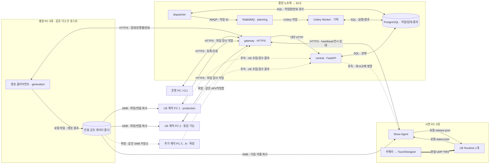

# 서버·노드 통신 파이프라인

이 문서는 **실행 중에 중앙 서비스와 현장 PC가 작업·파일·상태를 주고받는 흐름**을 설명한다.
코드 검사·이미지 빌드·배포 절차는 [CI/CD 문서](CI_CD.md), HTTP 요청·응답은 [통신 API 규약](COMMUNICATION_API.md)에 있다.

기준일은 2026-10-21, 대조 코드는 `develop`의 `bfd9b07`다. 문서의 **구현됨**은 해당 코드가 있다는 뜻이며,
EC2·실제 생성 PC·SMB·UE 화면에서 통합 검증을 끝냈다는 뜻은 아니다. 기존 시험 결과는
[인프라 검증 기록](../infra/VALIDATION.md)에 날짜·커밋별로 남아 있다.

## 1. 장비와 프로세스

여기서 **마스터 노드**는 중앙 제어 서비스를 실행하는 노트북 또는 향후 EC2를 가리킨다.
별도 물리 PC가 반드시 필요한 구성이나 RabbitMQ 클러스터의 master를 뜻하지 않는다.

| 위치 | 실행 주체 | 책임과 현재 범위 |
|---|---|---|
| 임시 노트북 → 향후 EC2 | `central`, `dispatcher`, `worker`, `postgres`, `rabbitmq` | API·기획 작업·작업 임대·기준 상태. 각각 Compose 컨테이너이며 현재 서버 간 통신은 같은 호스트의 내부 통신 |
| 중앙 진입점 | 선택적 `gateway`(Caddy) | 원격 HTTPS 접속을 `central:8000`으로 전달 |
| 운영 PC | PySide6·Qt Widgets 또는 운영 CLI | 운영자 요청·조회. 기존 앱의 전체 분산 작업 UI 연결은 후속이며 현재 분산 작업 등록은 CLI/API로 가능 |
| 현장 생성 PC | `infra/client.py`, 수동 Codex | `generation` 역할. 배경·에셋을 생성하고 결과 파일 목록을 보고. 현재 연결 대상 1대이며 실접속 확인은 남아 있음 |
| 현장 UE 제작 PC 초기 2대 → N대 | Python Node Agent, 향후 UE 조립 실행부 | `production` 역할. 현재 `bundle_verify` 파일 검사만 수행. 노드당 작업 하나, 같은 기능·카탈로그의 공통 작업함 사용 |
| 독립 시연 PC 1대 | Show Agent, 실행 중인 UE Runtime 1개, TD·카메라 | 로컬 작품 실행·다음 파일 준비·상태 보고. 제작·AI 지연과 현재 전시 실행을 분리하는 목표 |
| 생성 PC의 공유 저장 기능 | 전용 디스크 데이터 폴더·SMB | 생성 파일·번들 구성 파일 저장. 별도 공유 PC/NAS를 추가하지 않음 |

생성 PC와 UE 제작 PC는 **물리적으로 분리**한다. 초기 배치는 아래와 같이 확정했으며,
Windows Agent는 Celery Worker로 실행하지 않는다.

### 1.1 초기 현장 배치 — 2026-10-21 확정

| 물리 장비 | 초기 대수 | 역할·저장 위치 |
|---|---:|---|
| 생성 PC | 1 | 배경·에셋 생성과 공유 저장소 호스트. 전용 디스크 데이터 폴더를 SMB로 공유 |
| UE 제작 PC | 2 | 동일 기능의 제작 노드 1·2. 서로 다른 작품을 공통 작업함에서 임대하고 각자 로컬 SSD 캐시 사용 |
| 시연 PC | 1 | 제작 장비와 독립. 카메라·TD·UE Runtime 1개와 현재/다음 작품 로컬 캐시 |
| 별도 공유 저장 PC/NAS | 0 | 공유 저장 기능은 생성 PC가 겸함 |
| **합계** | **4** | 중앙 EC2와 임시 중앙 노트북은 현장 제작·시연 PC 4대에 포함하지 않음 |

운영 앱을 위한 별도 PC는 이 4대 구성에 추가하지 않으며 기존 현장 PC에서 실행할 수 있다.
EC2 제공 전 중앙 서버로 사용하는 노트북은 임시 장비다.

**UE 제작 노드는 초기 2대에서 N대로 확장**한다. 같은 코드·UE/플러그인·기능 카탈로그를 갖추고,
각 노드에 별도 ID·토큰·로컬 캐시를 부여해 같은 작업함에 연결한다. 노드당 조립 작업·UE 최대 1개이므로
전체 조립 동시 실행 상한은 초기 2개, 확장 시 가용 제작 노드 N개다. 큐 대기 용량과 처리 성능은 별도이며
이 수치는 실제 UE 조립 실행부·성능 검증 완료를 뜻하지 않는다. 생성 1대·시연 1대를 유지하면 현장 총대수는 **N+2대**다.

생성 PC의 로컬 저장 경로와 UE 제작/시연 PC의 SMB 경로는 같은 데이터 폴더를 가리킨다.
공유 계정·권한·용량·실제 경로는 [저장소 배치](../infra/STORAGE.md)에서 관리한다.

## 2. 전체 연결

아래 실선은 현재 코드의 전달 경로, 점선은 아직 연결해야 하는 경로다.
파일 전송은 화살표 라벨로 구분하며 상세 방식은 다음 표를 따른다.

HTTPS 화살표의 실제 연결은 **운영 PC/Agent가 중앙으로 시작**한다. 중앙이 현장 PC에 접속하거나
중앙에서 생성 PC의 Codex를 원격 실행하는 구조는 현재 구현하지 않았다.

| 송신 → 수신 | 방식·포트 | 주고받는 데이터 | 구현·경계 |
|---|---|---|---|
| 운영 CLI → FastAPI | HTTPS → gateway 443 → 내부 HTTP 8000 | 요청 ID, 작업 종류·명세, 의존 작업 ID. 응답은 작업 ID·상태 | 구현. 현재 EC2 운영 443·테스트 8444. 노트북 임시 서버의 과거 외부 포트 8443과 구분 |
| API/Dispatcher/Worker ↔ DB | 내부 PostgreSQL 5432 | 작업·시도·임대·노드·결과 메타데이터 | 구현. DB는 기준 상태이며 외부 PC에 직접 공개하지 않음 |
| Dispatcher → RabbitMQ → Worker | 내부 AMQP 5672 | `ranel.execute`, 인자 `[job_id]` 등 Celery JSON 메시지 | 구현. 파일·프롬프트 본문은 DB에 두고 작업 ID로 조회. 결과는 DB에 기록 |
| 생성·제작 Agent ↔ FastAPI | outbound HTTPS, JSON, 노드별 인증 | 임대 요청, 작업 본문, 선행 결과, 진행률, 소유권 토큰, 완료/실패 | 구현. 폴링/명시적 claim 방식이며 WebSocket·서버 push는 없음 |
| 생성·제작 PC ↔ 공유 폴더 | 같은 PC는 로컬 파일, 다른 PC는 현장 SMB TCP 445 | 이미지·영상·가공 파일·번들 구성 파일 | 파일 저장·검증 코드 구현. SMB 공유·계정·망 설정은 OS에서 준비하며 실제 장비 시험은 후속 |
| Show Agent → FastAPI | HTTPS, 시연 노드 토큰 | `Staged/Ready/Applied/Failed/Unknown`, 목표·활성 버전, Runtime 세션·PID | 상태 보고 구현. 중앙 게시 명령 수신은 후속 |
| Show Agent ↔ UE | 같은 PC의 JSON 파일 | `release.json`, `release.json.status.json` | 어댑터 구현. 실제 실행기·화면 연결 검증은 후속 |
| TD → UE | 현장 UDP 7001, 라넬 protocol v2 JSON | 출처·세션·sequence·좌표계·손/관람객 샘플 | 원본 센서 규약과 모의 입력 코드 존재. 자세한 규약·장비별 확인 범위는 [TD 문서](../td/README.md) |

관리 UI 15672, DB 5432, AMQP 5672, SMB 445는 EC2 인터넷 공개 대상으로 삼지 않는다.
Compose의 `central` 호스트 포트도 기본은 `127.0.0.1:18080`이다.

## 3. 현재 동작하는 작업 흐름

### 3.1 중앙 기획

1. 운영자가 `POST /infra/jobs`로 `diagnostic` 또는 `draft` 작업을 등록한다. API는 DB에 저장한 뒤
   **202와 작업 ID를 즉시 반환**한다.
2. Dispatcher가 DB 작업함을 조회해 `planning` 작업 ID를 RabbitMQ로 전달한다.
3. Linux Celery Worker가 DB 임대를 잡고 실행한다. 진단은 통신 확인 결과, 초안은 실제 기획 결과의 작품 ID·상태를 DB에 기록한다.
4. 운영자는 작업 조회 API로 결과를 확인한다. Worker 중단·브로커 장애 후 재전송과 임대 만료 처리가 있다.

초안 완료가 배경·에셋·UE 조립을 자동 등록하지는 않는다. 기획 결과를 다음 단계 요청으로 바꾸는 전체
작업 그래프 연결과 운영 앱의 비동기 작업 UI는 남은 작업이다.

### 3.2 배경 → 에셋

1. 운영자가 `background_generate`를 등록하고, 반환된 작업 ID를 `assets_generate.depends_on`에 넣는다.
   두 요청의 작품 ID·버전·카탈로그는 같아야 한다.
2. 생성 PC가 노드 heartbeat를 보내 등록하고 `POST /infra/agent/claim`으로 작업을 가져온다.
   중앙은 역할·카탈로그·빈 실행 슬롯·선행 작업 성공 여부를 확인한다.
3. 생성 키트는 공개 작업 내용 `assignment.json`과 비밀 임대 정보 `assignment.secret.json`을 분리한다.
   `--watch`는 임대·진행 상태를 갱신하며 **자동 claim이나 Codex 자동 실행을 하지 않는다**.
4. 사용자가 별도로 Codex를 실행한다. 입력 파일은 공유 저장소에서 가져오고 결과는 전용 폴더에 만든다.
5. 완료 명령이 결과 파일을 해시 저장소에 넣고, 중앙에는 상대 파일명·SHA-256·크기와 작품 ID·버전만 보낸다.
6. 배경 작업이 `succeeded`이면 에셋 작업을 임대할 수 있다. 다른 작품의 준비된 작업은 병행할 수 있으며,
   한 노드는 동시에 하나만 임대한다. 실패한 선행 작업의 후속 작업은 대기한다.

현재 `succeeded`는 **노드의 생성 완료 보고 수락**이다. 파일 실물·화질·조합 검수나 게시 승인까지 뜻하지 않는다.
직접 실행 순서는 [현장 실행 절차](../infra/WORKFLOW.md)에 있다.

### 3.3 제작 노드 N대

`bundle_verify`는 PostgreSQL의 공통 `assembly` 작업함에 들어간다. 동일한 `production` Agent들이
API를 통해 서로 다른 작업을 한 건씩 임대한다. 파일을 로컬 캐시에 복사하고 해시·크기를 검사한다.
성공 결과는 `check=file_integrity_only`, `publish_approved=false`다.

UE 조립·인터랙션 연결·프리뷰·성능 검사·자동 검수는 아직 이 실행 루프에 연결하지 않았다.
향후에도 노드당 UE 프로세스 1개 조건을 유지하고 에디터·검증 실행본이 필요하면 순차 실행해야 한다.

### 3.4 시연과 실제 적용

현재 Show Agent는 CLI로 지정한 manifest를 준비한다. 중앙에서 다음 작품 명령을 받는 API는 아직 없다.

| 단계 | 의미·현재 동작 |
|---|---|
| `Staged` | 파일을 로컬 버전 폴더에 준비. Runtime 준비 완료로 간주하지 않음 |
| watcher 전달 | 명시적 활성화 옵션에서만 `release.json`을 원자 교체. 기존 UE watcher가 내부 준비 후 자동 commit |
| `Ready` | UE 상태 파일이 준비 완료를 보고 |
| `Applied` | 살아 있는 프로세스·Runtime 세션·요청/활성 버전 일치와 상태 파일의 Applied를 확인한 뒤 중앙 보고 |
| 준비/통신 실패 | 기존 release·로컬 작품을 보존. 통신 복구 시 관측한 실제 활성 버전을 다시 보고 |

중앙이 `Ready`를 받은 후 별도 commit을 보내는 최종 교체 프로토콜, UE 자동 재시작·오프라인 복구,
실제 화면 출력·무중단 성능 검증은 후속이다. `pre_cooked_ue`는 계약상 구분하지만 현재 Show Agent는 준비를 거부한다.

## 4. 상태·재전송·파일의 기준

| 항목 | 현재 규칙 |
|---|---|
| 추적 | 요청 `request_id`, 작업 `id`, `attempt/attempt_id`, `node_id`, 생성·번들의 `artwork_id/version`으로 추적. 초안은 생성된 작품 ID를 결과로 돌려줌 |
| 요청 중복 | 같은 request_id와 같은 정규화 요청은 기존 작업 반환. 내용 변경은 409 |
| 작업 소유권 | DB 시간·임대 만료·노드 ID·시도별 토큰으로 확인. 이전 시도의 늦은 heartbeat/결과는 409 |
| 재시도 | 임대 만료는 한도 내 재배정. 명시적 실패는 `failed`이며 운영자 retry API로 한도 내 재등록 |
| 완료 응답 유실 | 생성 작업은 같은 시도·노드·토큰·같은 결과의 재전송을 허용. bundle_verify는 같은 완료 재전송을 허용하지 않음 |
| 파일 저장 | `objects/<해시 앞 2자리>/<SHA-256>`. 완성된 파일은 재사용하고 복사 후 해시·크기 확인 |
| 큰 파일 | EC2/API/RabbitMQ를 경유하지 않음. 중단된 파일은 파일 단위 재복사하며 바이트 단위 이어받기는 미구현 |
| 전시 유지 | 중앙 상태와 현장 활성 버전을 구분. 동기 제작의 prepared·과거 published와 파일 검사 성공을 실제 전시 Applied로 바꾸어 해석하지 않음 |

세부 필드·오류·재접속 방법은 [API 규약](COMMUNICATION_API.md), 용량·캐시·백업은 [저장소 설계](../infra/STORAGE.md)가 기준이다.

## 5. 구현과 검증, 남은 작업

| 영역 | 구현됨 | 기존 검증 근거 | 남은 작업 |
|---|---|---|---|
| 중앙 서비스 | API·DB 작업함·RabbitMQ·Worker·Dispatcher | 실제 컨테이너 진단/초안·Worker 재시작 검사 이력 | EC2 망·Registry·운영 부하 재검증 |
| 생성 연결 | 역할 인증·임대·의존성·진행률·완료 재전송 | 모의 API 및 실제 중앙 서비스를 이용한 테스트 파일 전달 이력 | 실제 생성 PC 접속·Codex 자동 실행·공급자 어댑터 |
| 저장·제작 노드 | 해시 저장소·공통 작업함·노드별 슬롯·캐시 검사 | 로컬 두 Agent 및 PostgreSQL 동시 임대 검사 이력 | SMB 권한/속도·실제 여러 PC·UE 조립 |
| 시연 | Staged/Ready/Applied 분리·PID/세션 관측·장애 시 기존 상태 보존 | 모의 Runtime 상태·준비/통신 장애 검사 | 중앙 게시 명령·별도 commit·실제 UE/TD·전환 성능 |
| 운영 UI | 기존 PySide6 앱·운영 CLI·조회/등록 API | 기존 화면·API 테스트 | 분산 작업 등록·진행률·재접속 복구·실제 적용 버전 UI |
| 전체 자동화 | 배경→에셋 의존성까지 연결 기반 | 해당 의존성과 다른 작품 병행 테스트 | 기획→생성→전처리→UE→자동 검수→게시 전체 연결 |

기존 시험과 이번 문서 작성 시점의 검증은 구분한다. 과거 GitLab 통과 결과가 이후 모든 변경의 통과를 뜻하지 않는다.

현재 동기 제작 API는 [최신 제작 정책](refactoring/creation-policy.md)에 따라 동작한다.
`RENDERER=both` 개발 경로는 두 후보 파일이 모두 준비돼야 `prepared`이며 활성 release.json은 바꾸지 않는다.
이는 현장 TD를 전시 렌더러로 확정하거나 /infra의 전체 분산 제작·시연 연결을 완료했다는 의미가 아니다.

## 6. EC2 이전 시 변경할 내용

### 6.1 설정과 배치

2026-10-22 중앙 서비스를 EC2로 이전했습니다. 아래 표는 이관 시 바뀌는 항목이며,
현재 주소·팀원 PC 설정·테스트는 [접속·테스트 안내](ENVIRONMENT_ACCESS.md)를 따릅니다.

| 항목 | 노트북 | EC2 이전 시 |
|---|---|---|
| 중앙 주소 | 노트북 HTTPS 주소 | 운영 앱 `CENTRAL_URL`, 생성 키트 `server.json.url`, 제작/시연 Agent `CENTRAL_URL`을 같은 EC2 HTTPS 주소로 변경 |
| TLS | Caddy 내부 CA·노트북 호스트 인증서 | 내부 CA 이관 또는 공인 인증서 방식을 결정. CA가 바뀌면 신뢰 파일도 갱신. 검증 우회 금지 |
| HTTPS 노출 | 노트북 IP:8443·Windows 방화벽 | 현재 운영 443·테스트 8444. `CENTRAL_HOST`, `CENTRAL_HTTPS_BIND`, 포트·보안 그룹·호스트 방화벽 조정. 현장 **공인 출구 IP** 기준 접근 |
| 내부 주소 | `postgres:5432`, `rabbitmq:5672`, `central:8000` | 같은 Compose 네트워크면 유지. 현재 구성은 DB·브로커를 별도 서버로 옮기는 변경이 아님 |
| 비밀 값 | 노트북 전용 .env·노드별 토큰 | EC2 전용 비밀 설정을 제한 경로에 전달. DB 복원 시 자격 증명 일치 확인. 토큰 변경 시 해당 노드도 갱신 |
| 현장 파일 | 생성 PC 1대의 전용 디스크 공유 폴더 | 생성 PC에 유지. UE 제작 초기 2대→N대와 시연 1대가 SMB로 접근. EC2에서 사설 SMB 경로를 직접 마운트한다고 가정하지 않음 |
| 캐시·Runtime | 각 Windows PC의 로컬 SSD·UE | 현장에 유지. 중앙 URL 변경과 UE/TD 실시간 입력은 별개 |
| 기획 공급자 | Compose는 `LLM_PROVIDER=none` 고정 | 외부 기획 공급자를 쓸 때 Compose 환경 전달을 명시적으로 추가. EC2의 localhost는 현장 Ollama가 아님 |
| CI Runner | 노트북 전용 Runner | EC2로 반드시 옮길 필요 없음. 노트북 Runner에서 SSH로 배포 가능 |

### 6.2 이관과 전환

1. 신규 요청·claim을 멈추고 실행 중 작업을 마친다.
2. 마지막 백업은 기존 중앙을 정지한 채 남겨 두는 방식으로 만든다. DB dump, 중앙 /data,
   서버 설정·CA·같은 코드 버전을 안전하게 옮긴다. 상세 절차는 [노트북 이관 안내](../infra/LAPTOP_SERVER.md)와 [복원 절차](../infra/RESTORE.txt)를 따른다.
3. 비어 있는 EC2 환경에 PostgreSQL·중앙 데이터·필요한 CA를 복원한다. 현장 공유 자산 전체는 이 백업에 포함되지 않는다.
   RabbitMQ 메시지를 복사하지 않고 DB 대기 작업을 Dispatcher가 다시 전달한다.
4. HTTPS·인증·DB·실제 비동기 작업 완료를 확인하고 생성 PC부터 주소를 전환한다.
5. 실제 생성 PC의 identity·heartbeat·claim·입력 복사·완료 재전송을 확인한 뒤 다른 노드를 전환한다.
6. 새 서버의 데이터·작업·노드 상태를 확인한 뒤 서비스 재개를 결정한다. 원본 노트북과 새 EC2를
   서로 다른 DB를 가진 활성 중앙으로 동시에 운영하지 않는다.

신규 작업이 EC2에 기록된 뒤 문제가 생기면 단순 DNS/주소 복귀만으로 원본을 재개하지 않는다.
요청을 멈추고 양쪽 작업·임대·파일 상태를 대조해 이관 또는 복귀할 기준 데이터를 정한다.

### 6.3 EC2 수용 검사

- [ ] health/ready뿐 아니라 진단·초안 작업이 RabbitMQ→Worker→DB를 거쳐 완료됨
- [ ] 생성 PC에서 TLS·노드 역할 확인, 임대·진행률·완료/동일 완료 재전송 확인
- [ ] 배경 성공 전 에셋 미배정, 성공 후 입력 전달, 다른 작품 병행 확인
- [ ] 임대 만료 후 이전 결과 거부, Worker/중앙 재시작 후 상태 복구 확인
- [ ] 실제 현장 SMB 읽기/쓰기 권한·해시·대용량 전송률 확인
- [ ] 시연 연결 시 실제 Runtime 활성 버전 보고, 준비·통신 실패 중 현재 작품 유지 확인

## 7. GitLab에 올릴 CI와 마스터 노드 구성

**Git 저장소에는 정의·소스·문서, Container Registry에는 빌드된 이미지, EC2에는 실행 컨테이너·데이터**를 둔다.
실행 중인 컨테이너나 DB 볼륨을 Git에 넣는 방식이 아니다. 아래 CI·Compose·Dockerfile은 이미 기준 develop에 있으며,
이번 문서는 통신 관점의 설명과 이관 준비를 추가한다.

| 대상 | GitLab에 관리할 것 | 실행·보관 위치 |
|---|---|---|
| CI/CD 정의 | [.gitlab-ci.yml](../.gitlab-ci.yml), [CI 설명](CI_CD.md), 검증 스크립트 | GitLab이 job을 만들고 현재 노트북 Runner가 실행 |
| 중앙 앱 이미지 | [infra/central/Dockerfile](../infra/central/Dockerfile), 소스, uv.lock | CI runtime 이미지 한 개를 빌드. API·Worker·Dispatcher가 실행 명령만 달리해 공유 |
| 중앙 컨테이너 5개 | [infra/central/compose.yaml](../infra/central/compose.yaml), [DB 초기 SQL](../infra/central/postgres-init.sql) | `central`·`worker`·`dispatcher`·`postgres`·`rabbitmq`를 EC2에서 실행 |
| 원격 HTTPS 진입점 | [compose.https.yaml](../infra/central/compose.https.yaml), [Caddyfile.internal](../infra/central/Caddyfile.internal) | 선택적 `gateway` 컨테이너. 내부 CA 설정이며 공인 인증서 방식은 후속 결정 |
| 배포·복구 | [deploy.sh](../infra/central/deploy.sh), [preflight.sh](../infra/central/preflight.sh), [smoke.py](../infra/central/smoke.py) | EC2의 /opt/ranel. SHA 이미지 교체·비동기 확인·이전 이미지 복구 |
| 노드 프로그램 | 생성 키트 발급 소스·Node/Show Agent·공통 계약 | Git에는 코드만. 실제 노드별 토큰이 든 발급 ZIP은 Git/공개 artifact 제외 |
| 운영 비밀·데이터 | 파일 내용은 커밋하지 않음 | SSH 키·서버 .env·CA 개인키·DB dump·대용량 자산은 제한된 저장·전달 경로 |

현재 CI는 **main에서만** 검증 이미지를 `$CI_REGISTRY_IMAGE:$CI_COMMIT_SHA`로 게시하도록 정의한다.
EC2 배포는 `main` + `EC2_DEPLOY_ENABLED=true` + 수동 실행이 필요하다. 이 기준 시점에는 main에 CI 파일이
아직 없어, 배포용 main 반영과 Registry·SSH 설정 확인이 먼저다. Registry 게시·EC2 배포 성공을 이번 문서로 보증하지 않는다.

**현재 deploy_ec2가 처리하는 범위**는 compose.yaml·postgres-init.sql·deploy.sh·smoke.py 전달과 기본 중앙 스택 교체다.
HTTPS override/Caddy 설정·CA/서버 환경 파일·첫 DB 복원·현장 노드 설정은 자동 전달하지 않는다.
EC2 첫 설치에서 별도로 준비하고, 이후 배포에서도 gateway가 유지·갱신되는지 경로·환경 변수·볼륨까지 검증해야 한다.
테스트 컨테이너와 Runner 자체도 중앙 운영 스택의 상시 컨테이너에 포함하지 않는다.

## 8. 코드 근거

- [HTTP 라우터](../apps/central/src/central/infra_api.py) · [요청/파일/시연 계약](../packages/contracts/src/contracts/infra.py)
- [작업 상태·임대·의존성](../packages/db/src/db/jobs.py) · [기획 Worker·Dispatcher](../apps/central/src/central/worker.py)
- [생성 클라이언트](../infra/client.py) · [제작 Agent](../apps/node_agent/src/node_agent/__main__.py)
- [시연 Agent](../apps/show_agent/src/show_agent/__main__.py) · [Runtime 상태 관측](../apps/show_agent/src/show_agent/runtime.py)
- [해시 저장소·캐시](../packages/studio/src/studio/infra/storage.py) · [운영 앱 현재 범위](../apps/operator/README.md)
