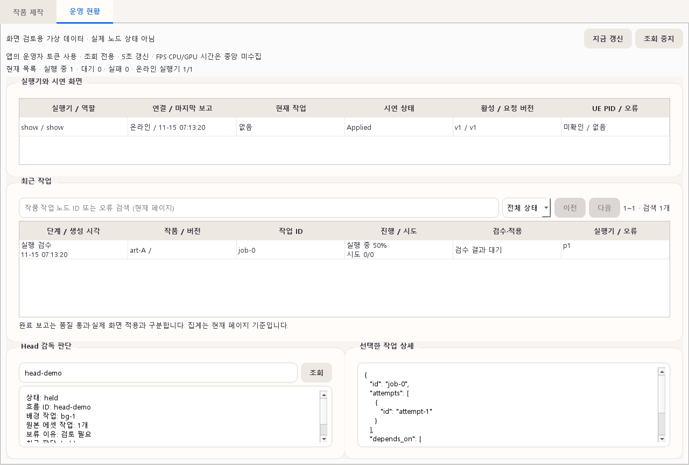

# 재생 정책 시뮬레이션 결과

2026-10-23 · S15P31A504-220. [설계·재현 명령](library-scheduler.md#9-가상-시간-시뮬레이션) · [전체 요약과 작품별 재생 횟수 JSON](library-scheduler-simulation.json).

**실제 UE·AI·EC2를 사용하지 않은 가상 시간 결과다.** 기본은 초기 작품 0개다. 생성·검수·다운로드가 끝난 작품이 20분마다 도착하고 한 번에 120초씩 재생된다고 가정했다. 최초 상영 우선, 최근 기준 2시간, 반복 슬롯 최근30/기존70을 적용했다.

## 8시간 비교

| 시나리오 | 종료 시 보유 작품 | 시도 / 정상 완료 / 실패 | 작품별 완료 최소~최대 / 평균 | 전체 최근 비중 | 반복 슬롯 최근 비중 |
|---|---:|---:|---:|---:|---:|
| **빈 시작(기본)** | 24 | 230 / 230 / 0 | 0~24 / 9.583 | 37.39% | 30.43% |
| 초기 20개 비교 | 44 | 240 / 240 / 0 | 0~6 / 5.455 | 34.58% | 30.46% |
| 초기 20개 + 전환 3초 | 44 | 235 / 234 / 0 | 0~6 / 5.318 | 34.62% | 30.37% |
| 생성 4건 누락 | 40 | 240 / 240 / 0 | 0~7 / 6.000 | 33.33% | 30.35% |
| 60~180분 목록 통신 단절 | 44 | 240 / 240 / 0 | 0~11 / 5.455 | 34.17% | 30.46% |
| 11번째마다 로딩 실패 + 전환 1초 | 44 | 261 / 237 / 23 | 0~6 / 5.386 | 34.60% | 30.41% |
| 100회 완료 후 스냅샷 복구 | 44 | 240 / 240 / 0 | 0~6 / 5.455 | 34.58% | 30.46% |
| 신규 제작 모두 지연, 기존20개 | 20 | 240 / 240 / 0 | 12~12 / 12.000 | 0% | 0% |

초기 작품은 모두 기존 그룹이다. 생성 누락은 2·5·9·17번째 도착을 생략했다. 전환 시간이 있는 두 조건은 8시간 끝에 진행 중인 시도가 한 건 남으므로 `시도 = 정상 완료 + 실패`가 아니다. 진행 중은 정상 완료에 넣지 않았다.

## 빈 대기열 동작

- t=0: 라이브러리·후보 모두 0, 첫 1,200초는 `재생 가능한 작품 대기`.
- t=20분: 첫 검증·캐시 완료 작품 자동 등록 후 최초 상영.
- 두 번째 작품 도착 전에는 첫 작품 하나뿐이므로 연속 회피를 완화한다. 이 구간의 연속 재생 9회는 정책 위반이 아니다.
- 이후 새 작품은 최초 상영을 우선하고 기존 작품과 반복한다. 상한20개·오래된 작품 삭제는 없다.
- t=480분: 24번째 작품 등록. 종료 시각이라 재생하지 않아 `new-24`의 시작·완료 횟수는 0이다.

초기20개 시나리오들도 신규 유입이 있는 경우 `new-24` 하나가 미상영으로 남는다. “총44개 확보”와 “44개 모두 8시간 안에 상영”을 같은 결과로 보고하지 않는다. 초기20개 비교에서는 연속 동일 작품 재생이 없었다.

## 실패·복구 해석

통신 단절 모형은 새 목록 동기화만 막는다. 기존 캐시를 계속 재생하고 복구 시 밀린 신규 작품을 등록한다. 중앙에만 있는 신규 작품은 단절 중 선택하지 않았다. 이는 실제 네트워크·디스크·UE 시험을 대신하지 않는다.

스냅샷 복구 시 100회 정상 완료 카운터가 보존됐으며 기준 조건과 최종 작품별 횟수가 일치했다. 별도 단위 테스트는 재생 중 상태 복구가 자동 완료로 바뀌지 않고, 같은 시작·종료 이벤트 재전송이 횟수를 더하지 않음을 확인한다.

최근 비중은 최초 상영을 포함한 전체 결과와 그 슬롯을 제외한 배분 결과를 함께 보고했다. 기존 그룹이 없는 빈 시작 초기 구간이나 신규가 전혀 없는 조건에서는 30/70을 그대로 채울 수 없다. 평균은 종료 시 보유 작품 전체(마지막 미상영 포함) 기준이며 첫 작품이 오래 단독 재생된 빈 시작에서는 횟수가 같아질 수 없다.

## UI 미리보기

아래는 기존 PySide6 앱의 새 `운영 현황` 탭이다. **가상 데이터로 렌더링한 화면이며 현재 EC2 상태가 아니다.** 맑은 고딕을 명시적으로 로드해 offscreen 한글을 검토했다.

실제 운영 API의 인증·조회는 로컬 FastAPI TestClient로 검사했다. 확인 당시 열려 있던 EC2 웹 모니터는 갱신 실패 표시가 있어 그곳의 수치를 최신 실측 결과로 사용하지 않았다.

## 로컬 검증 기록

- 전체 pytest: **734 passed, 14 skipped**, 441.61초. Python3.13.15·전체 workspace 설치·Qt offscreen으로 실행했다.
- controller unittest: **184개 중181 passed, 3 skipped**. 회사 원본 파일은 변경하지 않았다.
- 새 정책·모니터 focused 검사18개 통과. 기존 창의 새 탭 통합 검사도 전체 실행에 포함했다.
- ruff·잠금 파일 일치·Git 공백 검사 통과. Starlette TestClient/httpx의 기존 방식과 timeout 인자에 관한 폐기 예정 경고4건은 오류가 아니며 의존성을 이번 범위에서 교체하지 않았다.
- pytest 생략은 TEST_POSTGRES_URL 미설정8건·선택 Pillow 미설치6건이다. CI의 분리된 DB·Qt 검사는 MR에서 별도 확인한다.

생산 API·DB 변경·PC2 순환 재생·UE 실제 완료 신호·LED 화면은 이 단계의 검증 범위에 포함하지 않는다.
