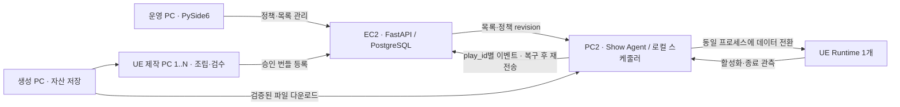

# 누적 작품 라이브러리·재생 스케줄러 설계

관련 작업: S15P31A504-220. 현행 분석 기준: develop `52d368e` (2026-10-23).

**이번 단계는 PySide6 운영 모니터 구현과 재생 정책 설계·시뮬레이션이다.** 아래 신규 DB·API·PC2 순환 재생은 설계안이며 아직 서버에 연결하지 않는다. 기존 생성·게시·UE 코드는 유지한다.

## 1. 시작 조건과 배치

사용자 확인에 따라 **실제 테스트 기본값은 작품 0개·재생대기열 0개**다. 테스트 작품 20개를 자동 주입하지 않는다. 첫 작품이 검증·승인되고 PC2 캐시까지 준비되면 자동 후보가 된다. 준비 전에는 `재생 가능한 작품 대기`를 표시한다. 마지막 정상 작품이 있다면 계속 유지하고, 한 작품만 있으면 연속 제한을 풀어 반복한다.

첨부안의 초기 20개는 별도 비교 시나리오다. 제작 장비는 기존 설계의 생성 PC 1대·UE 제작 PC 2대(향후 N대)·독립 시연 PC2 1대를 유지한다. 20분/개는 시뮬레이션 전체 유입률 가정이며 제작 노드 수의 제한이 아니다.



EC2는 메타데이터·정책의 기준 상태다. PC2는 마지막 검증 목록과 파일로 재생을 이어가는 유일한 실행 주체다. 중앙 API의 응답을 매 재생마다 기다리지 않는다. 현재 파일 전달 구현의 HTTP `/infra/files`와 현장 공유 디스크 목표는 [통신·API 문서](../COMMUNICATION_PIPELINE.md)를 기준으로 구분한다.

## 2. 현행 코드와 바꿀 지점

| 현행 위치 | 현재 동작 | 후속 연동 변경 |
|---|---|---|
| `packages/db/src/db/jobs.py` | `ue_publish`를 exhibition 작업 큐에 넣고 준비된 작업을 생성 시각순 임대 | 제작용 작업 큐는 유지. 전시 후보 라이브러리·상영 이력과 분리 |
| `packages/studio/src/studio/head/publication.py` | 검수·승인 확인 후 시연 노드의 게시 작업 생성 | 자동 모드에서는 승인 버전을 라이브러리에 등록·동기화하고 다음 순서는 스케줄러가 결정 |
| `apps/central/src/central/runtime_flow.py` | 조립 뒤 실행 검수·승인·게시 연결 | 검수 실패는 기존 재작업 경로. 실패 작품은 재생 후보가 아님 |
| `apps/show_agent/src/show_agent/runtime.py`, `infra/runtime_worker.py` | 번들 준비, `release.json` 원자 교체, Ready/Applied 확인 | 반복 재생 세션과 로컬 정책·이벤트 저널 추가 |
| `infra/show_supervisor.py` | 선택적 UE 자동 실행·복구·중복 방지 | 기존 프로세스 관리 재사용. 매 작품마다 UE를 종료·재시작하지 않음 |
| `ue/runtime/.../ArtworkSceneHostLoading.cpp` | 세션·PID·RequestId·활성 버전·로드 단계 상태 파일 기록 | 작품 정상 종료/상영 구간 관측 계약이 별도 필요 |
| `apps/operator/src/operator_app/monitor.py` | **이번 구현:** Qt Widgets로 기존 관리자 정보 조회 | 재생 라이브러리·정책 편집 화면은 후속 API와 함께 연결 |

현재 코드에는 고정 20개 상한의 작품 라이브러리나 자동 삭제 스케줄러가 없다. 기존 작업 큐의 FIFO 임대를 완성된 재생목록으로 해석하지 않는다. 기존 PySide6의 `전시 모드` 체크박스는 연속 제작 요청이며 PC2 재생 스케줄러가 아니다.

`Ready`는 다음 작품 준비, `Applied`는 실행기 활성화 보고다. 소스의 `FirstDisplayVerified=false`도 별도 남으므로 실제 LED 화면 품질을 보장하는 신호로 쓰지 않는다. Applied만으로 120초 정상 완료를 집계하지 않는다. UE 내부 동작의 `Completed` 이름도 작품 상영 완료 계약으로 간주하지 않는다.

## 3. 라이브러리 자동 등록과 데이터 모델 — 제안

중앙 등록 조건은 **조립 완료 + 실행 검수 통과 + 게시 승인 + 불변 번들/해시 등록**이다. 미리보기 예외 승인(`display_preview_only`)은 정식 라이브러리에서 제외한다. PC2의 실행 후보가 되려면 다운로드·해시·카탈로그 호환성 검사까지 통과해야 한다.

동일 `(artwork_id, version)` 등록은 멱등 처리한다. 같은 버전의 파일을 바꾸면 충돌로 거절하고 새 버전을 발행한다. 과거 버전은 보존하며 작품당 활성 후보 버전은 하나만 둔다. 재생 횟수·연속 회피는 논리 작품 ID 기준으로 관리해 버전만 바꾸어 우선권을 초기화하지 않는다. 최초 상영 전 새 버전으로 교체된 경우 최초 상영 시각은 계속 비어 있다.

| 저장 대상(신규 테이블 제안) | 주요 데이터와 제약 |
|---|---|
| `exhibition_artwork` | 작품 ID·제목·created_at·validated_at·활성 버전·enabled·상태·목표 시간·선택 우선순위 |
| `exhibition_version` | 작품 ID+버전 unique, manifest·배경/에셋/scene 파일 참조·SHA-256·catalog_version·승인 근거·원본 작업/시도 ID |
| `exhibition_policy` | revision·최근 기준 7200초·최근 비중 0.3·최근 N회 회피·반복/일시중지·실패 정책·수정자 |
| `exhibition_play` | play_id unique, show_node_id·실행 세대·작품/버전·정책 revision·선택 이유/그룹·선택/시작/종료 시각·결과·실패 원인 |
| `exhibition_event` | event_id unique, play_id·노드 세션·순번·발생/수신 시각·Runtime 세션/PID/RequestId·확인 근거 |
| 집계 | attempt_count·started_count·play_count·first_played_at·last_played_at·실패 횟수·최근 결과. 이벤트와 같은 트랜잭션에서 갱신 |

중앙 DB는 PostgreSQL을 유지한다. PC2 저장은 우선 원자 교체 JSON 스냅샷+내구성 있는 이벤트 저널을 설계하며 SQLite는 필요가 확인될 때 추가한다. 실제 DB 마이그레이션은 이번 변경에 포함하지 않는다. 프로토타입의 `Artwork.artwork_id`는 버전이 고정된 단일 항목이며 버전 승계 집계는 후속 통합 테스트 대상이다.

라이브러리는 누적 보존한다. PC2 디스크 캐시는 별개로 용량 정책을 둘 수 있지만 현재/다음/마지막 정상 작품은 보호하고 캐시 정리가 중앙 원본 삭제로 이어지지 않게 한다. 저장 용량·경고 임계치는 실제 파일 측정 후 정하며 임의 수치를 넣지 않는다.

## 4. 선택 정책

1. enabled이고 승인·검증·로컬 준비 완료, 실패 대기 시간이 지난 후보를 모은다. 준비 중 작품은 기다리게 하되 현재 작품을 중단하지 않는다.
2. 직전 작품과 최근 N회 작품을 피한다. 후보가 없으면 오래된 회피 항목부터 풀고, 한 작품뿐이면 그 작품을 허용한다. 완화 이유를 기록한다.
3. 한 번도 **실제 시작하지 않은** 작품(`first_played_at=null`)이 있으면 validated_at → created_at → 고정 ID 순서로 선택한다. 로딩 실패는 여전히 최초 상영 대상이다. 시작 후 실패한 작품은 최초 시작으로 기록하되 정상 완료 횟수는 0이다.
4. 최초 상영 대상이 없을 때 **최근 30% / 기존 70%**를 목표로 한다. 최근은 `0 ≤ now - validated_at < 7200초`, 기존은 그 이전이다. 두 집합은 겹치지 않는다.
5. 반복 재생의 정상 완료 슬롯 수를 T, 최근 완료 수를 R이라 할 때 `R < (T+1)×0.3`이면 최근 그룹, 아니면 기존 그룹을 우선한다. 그 그룹이 비었으면 다른 그룹을 선택한다.
6. 그룹 안에서는 정상 완료 횟수 오름차순 → 마지막 실제 시작이 오래된 순 → 등록 시각 → 고정 ID 순서로 선택한다.

신규 최초 상영은 30/70 배분 카운터에서 제외하고 별도로 집계한다. 그룹 부족으로 대체한 정상 완료는 실제 선택 그룹에 기록해 이후 비중을 보정한다. 따라서 전체 상영의 최근 비율은 정확히 30%일 필요가 없다. 후보 부족·우선 상영·오프라인 캐시 제한도 비중에 영향을 준다. 그룹별 균형과 전체 작품의 동일 횟수는 다른 목표다.

최초 상영 우선은 실행 가능한 후보 사이의 우선순위다. 신규 유입이 상영 처리량보다 많아지면 대기 시간이 늘고 기존70% 목표도 밀릴 수 있다. 이때도 작품을 삭제하지 않고 미상영 수·최장 대기를 운영 화면의 경고 대상으로 둔다.

기본 상영 목표는 작품별 120초이며 이후 운영 UI에서 변경할 수 있게 한다. 자동 순서는 위 정책이고 반복은 기본 계속이다. 추후 수동 고정 순서·다음 작품 지정·건너뛰기·유한 반복은 예외 모드로 구분하고 정책 revision과 조작 이력을 남긴다. 자동 우선권과 수동 지정을 동시에 보장한다고 표시하지 않는다.

검토용 코드의 실패 대기 60초·연속 3회 실패 시 비활성은 **시뮬레이터 기본값**이다. 운영 수치 확정이 아니며 `Policy`로 바꾸어 비교한다. 실패는 정상 완료 수를 올리지 않는다.

## 5. 재생 상태와 완료 근거

```text
EMPTY / WAITING ──검증 후보 도착──> SELECTED → LOADING → READY → PLAYING → FINISHED
                                              └─실패─> ERROR → COOLDOWN / DISABLED
```

현재/다음 작품 상태는 별도로 보관한다. 다음 작품 LOADING/READY 동안 현재 작품을 유지한다. 다음 활성화 실패는 현재 상태를 덮지 않는다. READY→PLAYING은 실제 Runtime 세션·PID·RequestId·활성 버전이 요청과 일치한 Applied 관측 이후다. 단일 UE 인스턴스에 같은 데이터 전환 계약을 사용한다.

| 카운터 | 증가 조건 |
|---|---|
| attempt_count | 새 play_id로 로딩 시도 기록 |
| started_count | 해당 play_id의 실제 활성화 근거를 처음 수신 |
| play_count | 그 시작에 대응하는 정상 종료 근거를 처음 수신 |

목표 시간 만료는 다음 전환을 **요청할 계기**이며 완료 증거가 아니다. 후속 구현은 UE가 상영 구간 완료를 보고하는 계약 또는 연속 관측으로 검증한 구간 완료 계약 중 하나를 명시해야 한다. 정적·루프 작품도 해당 계약이 필요하다. 프로세스 중단·관측 공백·재부팅으로 완료 근거가 사라진 세션은 `interrupted/unknown`으로 남긴다.

이번 순수 정책 모듈은 SELECTED를 start로 받아 LOADING, applied로 PLAYING, 확인된 complete로 FINISHED를 모사한다. 별도 READY 단계·파일 I/O·실제 종료 관측 어댑터는 구현하지 않았다. `simulated_runtime_finished`는 가짜 시험 이벤트이며 UE 지원 기능이 아니다.

## 6. 중앙 API·이벤트 — 후속 계약 초안

**아래 경로는 제안이며 현재 호출하면 동작하지 않는다.** 앱끼리 공유하는 최종 모델은 `packages/contracts`에 정의하고 인증·범위·오류 응답과 함께 확정한다.

| 경로 제안 | 권한 / 데이터 |
|---|---|
| `GET /infra/exhibition/artworks` | 운영자: 작품·버전·상태·횟수·페이지·후보 제외 이유 |
| `PATCH /infra/exhibition/artworks/{id}` | 운영자: enabled·목표 시간. expected_revision으로 동시 수정 충돌(409) 검사 |
| `GET/PATCH /infra/exhibition/policy` | 운영자: 정책과 revision; 기본 2시간·30/70 |
| `GET /infra/exhibition/state` | 운영자: 현재/다음·실제 적용 버전·마지막 동기화·오프라인·최근 오류 |
| `GET /infra/agent/exhibition/snapshot?after_revision=...` | 시연 Agent: 승인 목록·불변 번들 참조·정책·노드 실행 세대 |
| `POST /infra/agent/exhibition/events` | 시연 Agent: 이벤트 배치와 마지막 승인 순번. 중복은 동일 응답, 내용 충돌은409 |
| `POST /infra/agent/exhibition/reconcile` | 시연 Agent: 로컬 revision·미전송 이벤트·실제 세션/활성 버전 대조 |

이벤트 예시(설계용):

```json
{
  "event_id": "evt-show1-epoch7-0021",
  "play_id": "play-a-001",
  "show_node_id": "ue-show-1",
  "execution_epoch": 7,
  "sequence": 21,
  "policy_revision": 4,
  "artwork_id": "art-A",
  "version": "v3",
  "type": "started",
  "occurred_at": "2026-10-23T03:00:00Z",
  "runtime": {"session_id": "session-1", "pid": 18420, "request_id": 9},
  "evidence": {"phase": "Applied", "active_version": "v3"}
}
```

인증 토큰은 본문·로그에 넣지 않는다. 작업 ID·시도 ID·소유권 토큰은 기존 제작 작업 임대용이며 play_id와 구분한다. 중앙 집계는 event_id/play_id unique 제약과 트랜잭션으로 재전송에도 한 번만 반영한다. 늦은 과거 세션의 유효 이력은 보존하되 현재 활성 상태를 덮지 않는다.

## 7. 오프라인·재시작·게시 경합

- PC2는 검증된 파일·목록·정책 revision·배분 카운터·최근 이력·진행 중 play_id를 원자 저장하고 이벤트를 내구성 있게 기록한다. 스케줄러는 네트워크와 무관한 로컬 선택을 수행한다.
- 중앙 단절 중 새 작품은 중앙에만 누적된다. PC2는 기존 캐시로 계속 순환한다. 연결 복구 후 승인 목록을 내려받고 해시·호환성 검사를 마친 작품만 후보로 추가한다.
- 중앙 재시작은 PC2 재생을 초기화하지 않는다. PC2 재시작 때는 UE 실제 세션/버전과 저널을 먼저 대조한다. 진행 중 기록을 자동 완료 처리하거나 재생 횟수를 두 번 더하지 않는다.
- 제어 주체는 PC2의 단일 Show Agent다. 로컬 잠금+기존 프로세스 관리로 중복 실행을 막는다. 중앙의 소유권 만료만으로 오프라인 PC2 옆에 두 번째 실행기를 자동 활성화하지 않는다. 장비 교체는 기존 실행 중지 확인 뒤 새 execution_epoch를 발급한다.
- 기존 `ue_publish`와 새 스케줄러가 동시에 `release.json`을 바꾸면 안 된다. 후속 전환에서 자동 게시를 라이브러리 등록으로 바꾸고, 실제 포인터 교체는 단일 Show Agent에 모은다. 수동 미리보기는 명시적 일시중지/예외 세션으로 격리한다.
- 신규 생성 지연·제작 실패·로딩 실패 동안 마지막 정상 작품을 유지한다. 첫 작품도 없으면 대기 화면을 사용한다. 모든 캐시 손상·GPU/장비 장애까지 무중단을 보장하지 않으며 승인된 기본 화면과 현장 복구가 필요하다.

JSON 복구 테스트는 카운터·진행 중 상태 보존과 중복 반영 방지를 확인한다. 파일 내구성·디스크 고장·실제 네트워크 단절·UE 복구는 후속 통합 검증 대상이다.

## 8. PySide6 운영 모니터 — 이번 구현

운영 앱의 `작품 제작` 옆에 `운영 현황` 탭을 추가했다. 브라우저를 삽입하지 않고 기존 Qt Widgets·운영자 인증 HTTP 클라이언트를 사용한다.

| 웹 관리자 요소 | 앱 표시 / 기존 API |
|---|---|
| 실행 중·대기·실패·온라인 집계 | 현재 페이지 집계 / `GET /infra/jobs?limit=200&offset=...`, `/infra/nodes` |
| 실행기 역할·heartbeat·현재 작업 | 노드 표 |
| 시연 단계·활성/요청 버전·PID·오류 | 시연 노드 보고. 오프라인·갱신 실패면 현재 상태 미확인 |
| 단계·작품/버전·진행·시도·검수·적용 | 작업 표. 완료 보고·검수 통과·미리보기·Applied 분리 |
| 검색·상태·이전/다음 | 현재 페이지 검색·200개 단위 이동 |
| 시도 이력·의존성·원본 결과 | 선택 행의 상세 / `GET /infra/jobs/{id}` |
| Head 보류·최근 판단·에셋 수 | 흐름 ID 조회 / `GET /infra/head/workflows/{id}` |
| 5초 갱신·연결/중지 | 선택된 탭만 자동 조회. 수동 중지/401은 표시 자료 삭제 |

네트워크 작업은 화면 스레드를 막지 않는다. 겹치는 자동 조회는 쌓지 않고, 중지·페이지 변경 전에 시작한 늦은 응답은 무시한다. 오류에 토큰·원시 네트워크 예외를 노출하지 않는다. FPS·CPU/GPU 시간은 중앙 미수집으로 표시한다.

후속 관리 화면은 라이브러리(작품·횟수·상태·시간·enabled), 정책 설정, 현재/다음과 선정 이유, 최근 실패·이력을 별도 제공한다. 아직 연결되지 않은 재생 버튼이나 가짜 대기열을 현재 기능처럼 보여 주지 않는다.

## 9. 가상 시간 시뮬레이션

실행 위치는 저장소 루트다. 설치·기본 테스트는 [AGENTS.md](../../AGENTS.md)를 따른다.

```powershell
# 기본: 빈 라이브러리, 20분마다 검증·캐시 완료 작품이 도착한다고 가정
uv run python infra/simulate_exhibition.py
# 초기 20개는 별도 비교이며 기본 테스트에 주입하지 않음
uv run python infra/simulate_exhibition.py --initial-artworks 20 --load-seconds 3
# 전체 시나리오 + 작품별 횟수·play_id 원장
uv run python infra/simulate_exhibition.py --all-scenarios --output runtime/scheduler-simulation.json
```

실제 AI·UE·EC2·생산 DB/API를 호출하지 않는다. 가상 종료 이벤트를 넣어 정책만 검증한다. 생성 주기는 조립·검수·승인·캐시까지 끝난 유입 간격으로 단순화했다. 오프라인은 목록 동기화를 막으며 기존 캐시 재생을 유지하는 모형이다. 재시작 시나리오는 100회 완료 뒤 스냅샷 복구이며 실제 프로세스 강제 종료 실험이 아니다.

결과와 읽는 법은 [시뮬레이션 결과](library-scheduler-simulation.md), 원시 요약은 [JSON](library-scheduler-simulation.json)에 있다. 8시간 종료 시각에 도착하는 24번째 신규 작품은 등록되지만 최초 상영할 시간이 없다. 기본 0개 시작에서는 첫 20분 대기하므로 이상적인 완료 상한도 240회가 아닌 230회다.

## 10. 후속 구현 순서와 완료 조건

1. 팀 검토로 정상 종료 관측 계약·상영 시간/반복 예외·실패 임계치 확정.
2. contracts 모델과 PostgreSQL 라이브러리/이벤트 마이그레이션, 승인 이벤트의 멱등 등록. 기존 데이터 자동 편입은 정식 승인 근거가 있는 작품만 대상으로 검토.
3. Show Agent의 단일 제어권·파일 캐시·정책 스냅샷·이벤트 저널·재연결 대조 구현. 기존 publisher 경합 제거.
4. PySide6 라이브러리/재생 정책 편집 API 연결. 운영 앱을 닫아도 중앙 제작과 PC2 재생 지속.
5. 빈 시작→첫 승인 작품 자동 등록→PC2 준비→실제 Applied→정상 종료 집계, 다음 작품 전환, 통신 단절·중복 이벤트·재부팅·실패 복구를 실제 장비에서 검증.

이번 MR은 설계 검토와 모니터 기능을 위한 Draft다. 실제 자동 재생·무중단 전환·LED 성능 검증 완료를 뜻하지 않으며 merge·운영 배포하지 않는다.
