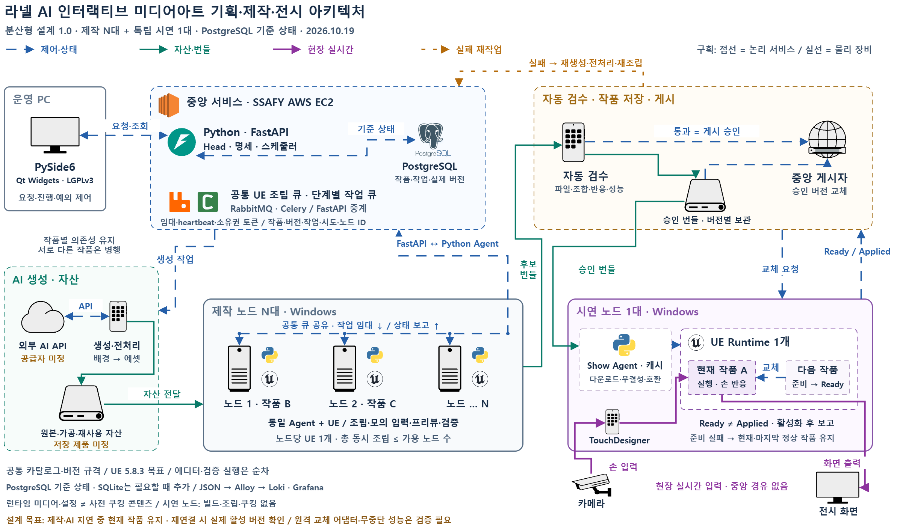

# 라넬 AI 인터랙티브 미디어아트 — 기술스택 채택 근거

초안: 2026-10-16 · 갱신: 2026-10-21 · 기준: 기존 기술 선택과 초기 현장 배치 결정 / 도면은 아키텍처 v4

이 문서는 목표 구조의 선택 이유다. [현재 GitLab 구현과의 차이](./README.md#현재-구현과-목표-설계)를 구분해 읽는다.

**2026-10-19 결정:** 사용자가 **PySide6 + Qt Widgets의 LGPLv3 이용 경로**를 선택했습니다. 앱 고유 소스는 비공개로 유지하며, 운영 PC의 앱 → EC2 FastAPI 구조도 유지합니다. 현재는 기업 요청 프로토타입 단계입니다. 실제 배포본의 버전·고지·대응 소스 제공·라이브러리 교체 검증은 [배포 체크리스트](./pyside6-distribution-checklist.md)로 관리합니다.

**저장소 규칙과의 정합성:** 2026-10-19에 확인한 `AGENTS.md`와 `docs/THIRD_PARTY.md`에는 GPL 계열 제한이 명시돼 있다. PySide6의 LGPL 선택은 사용자 결정으로 유지하지만, 이를 회사의 공식 예외 승인으로 보지 않는다. Loki·Grafana 등 선택한 구성 전체도 실제 제품·버전·사용 및 배포 범위에 따라 규칙과 대조한다. [라이선스 정합성](./README.md#라이선스-정합성)에 검토 항목을 모았다.

**2026-10-19 DB 방침 확정:** PostgreSQL을 기준 DB로 사용하고 SQLite는 초기 구성에 넣지 않습니다. 로컬 초안·캐시 등의 필요성이 확인될 때 추가를 검토합니다. 첨부안의 장점을 기존 구조에 통합한 현재 설계는 [분산형 설계 수정본](./distributed-system-design.md)에 정리했습니다. 공통 큐와 제작 노드 N대, 독립 시연 노드 1대의 구조는 유지합니다. 첨부안에서 반영한 내용과 변경점은 같은 설계 문서 19절에 정리했습니다.

**2026-10-21 초기 배치 확정:** 생성 PC 1대·UE 제작 PC 2대·시연 PC 1대, 총 4대입니다.
공유 저장소는 생성 PC의 전용 디스크 폴더를 SMB로 공유합니다. 기존 장비를 활용해 별도 공유 PC/NAS를
추가하지 않고 현장 유선망으로 큰 파일을 전달하기 위한 선택입니다. 생성·UE 제작·시연 역할은 물리적으로
분리하며 UE 제작은 공통 작업함과 동일 Agent 규격으로 N대까지 확장합니다. 실제 경로·권한·용량·성능·백업은
[저장소 배치](../../infra/STORAGE.md)에 따라 검증합니다.

[편집 가능한 아키텍처 원본](./assets/ranel-ai-architecture.drawio) · [전체 미리보기 PNG](./assets/architecture-overview.png) · [확대용 SVG](./assets/architecture-overview.svg)

원본에는 이전 4개 페이지와 최신 `분산형 설계 · 도형 중심` 페이지가 함께 있습니다.

현재 구성도의 기술 선택 기준은 **팀의 Python 경험 활용, 기존 라넬 코드 재사용, 제작 노드 확장, 전시 실행의 독립성 확보**입니다. 아래는 각 기술의 역할과 프로젝트 요구사항에 따른 채택 이유입니다.

중앙제어와 운영 화면에 사용하는 기술입니다.

| 기술 | 담당 역할 | 채택 이유 |
|---|---|---|
| **Python** | 중앙 서비스·Worker·Agent·운영 앱 구현 | 팀이 가장 익숙한 언어이므로 개발과 문제 해결 부담을 줄일 수 있습니다. AI API 연동, 자산 전처리, 운영 자동화를 같은 언어로 구현할 수 있습니다. |
| **[FastAPI](https://fastapi.tiangolo.com/features/)** | 운영 앱과 각 Agent가 연결하는 중앙 API | Python 기반으로 요청 데이터 검증과 API 문서 생성을 지원합니다. 작품 요청, 작업 임대, heartbeat, 결과 보고의 데이터 규격을 명확하게 정의하기 좋습니다. |
| **[PySide6](https://doc.qt.io/qtforpython-6/)** | 운영 PC의 설치형 앱 구현 — LGPLv3 경로 선택 | 운영 화면까지 Python으로 개발해 팀의 언어 경험을 활용할 수 있습니다. 운영 PC에서 실행하면서 EC2의 FastAPI에 연결하는 구조에 맞습니다. LGPL 조건을 충족하는 배포 방식으로 앱 고유 소스를 비공개로 유지합니다. |
| **[Qt Widgets](https://doc.qt.io/qtforpython-6/PySide6/QtWidgets/index.html)** | 작품 목록·노드 상태·작업 진행률·예외 제어 화면 | 표, 트리, 버튼, 진행률 표시 등 운영 도구에 필요한 기본 UI 요소를 제공합니다. 상태 확인과 작업 제어가 중심인 화면을 구성하기 적합합니다. |
| **AWS EC2** | 중앙 API·큐·DB 등 논리 서비스의 실행 환경 | SSAFY에서 제공하는 자원을 활용하기로 했기 때문입니다. 여러 제작 노드와 시연 노드가 공통으로 접근하는 중앙 접점을 마련할 수 있습니다. 인스턴스 사양과 OS·배포 방식은 별도 확정 대상입니다. |

운영 앱과 중앙 서비스를 분리한 이유는 **운영자가 앱을 종료해도 제작 작업과 현재 전시가 계속되도록 하기 위해서**입니다. 이 동작은 서비스와 Agent가 UI 실행 여부에 의존하지 않도록 구현해야 합니다.

작업 처리와 상태 관리에는 다음 기술을 선택했습니다.

| 기술 | 담당 역할 | 채택 이유 |
|---|---|---|
| **[RabbitMQ](https://www.rabbitmq.com/docs/confirms)** | 작업 메시지 전달·대기열 관리 | 이미지·영상 생성이나 조립처럼 처리 시간이 긴 작업을 대기열에 보관하고 Worker에 전달하기 위해 선택했습니다. 확인 응답과 재전달 기능을 바탕으로 장애 복구 흐름을 구성할 수 있습니다. |
| **[Celery](https://docs.celeryq.dev/en/stable/getting-started/introduction.html)** | 중앙의 비동기 작업 실행·재시도 | Python 함수로 작업을 정의하고 Worker에서 실행할 수 있어 팀 환경에 맞습니다. 오래 걸리는 생성·전처리 작업을 API 요청 처리와 분리하고, 작업별 재시도 정책을 구현하는 데 사용합니다. |
| **[PostgreSQL](https://www.postgresql.org/docs/current/explicit-locking.html)** | 작품·작업·임대·노드·버전의 기준 상태 저장 | 여러 제작 노드가 동시에 작업을 요청하고 결과를 보고하므로 일관된 상태 관리가 필요합니다. 트랜잭션과 잠금을 활용해 작업 소유권, 상태 전이, 승인 버전을 관리하기 위해 선택했습니다. |
| **Python Node Agent·Show Agent** | Windows 노드의 작업 수신·UE 프로세스·캐시·상태 보고 관리 | 팀의 Python 경험을 활용하면서 UE 외부에서 프로세스 수명과 복구를 관리할 수 있습니다. 같은 Agent 규격을 적용해 조건을 충족한 제작 노드를 N대로 늘릴 수 있습니다. |

**RabbitMQ는 작업 전달, Celery는 비동기 작업 실행, PostgreSQL은 기준 상태 관리**를 맡습니다. 메시지가 재전달될 수 있으므로 중복 실행과 늦은 결과 반영은 작업 ID·임대·소유권 토큰으로 별도 제어합니다.

Celery는 Windows를 공식 지원하지 않으므로, **Windows UE 노드는 Python Agent가 FastAPI를 통해 작업을 임대하는 방식**으로 설계했습니다. Celery는 지원되는 중앙 실행 환경에서 사용합니다. [Celery 공식 안내](https://docs.celeryq.dev/en/stable/getting-started/introduction.html)

제작과 전시 영역은 기존 라넬 구현과 장비 조건을 중심으로 선택했습니다.

| 기술·방식 | 담당 역할 | 채택 이유 |
|---|---|---|
| **Windows** | 제작·시연 노드 OS | 제작과 시연의 OS를 통일해 UE·TouchDesigner·플러그인·장치 연결의 검증 기준을 맞추기 위해 선택했습니다. 노드 증설 시에도 동일한 환경을 재현하기 쉬워집니다. |
| **Unreal Engine 5.8.3** | 작품 조립·프리뷰·실시간 전시 | 기존 라넬의 UE 기반 렌더링과 인터랙션 구조를 재사용하기 위해 선택했습니다. **5.8.3은 사용자가 지정한 목표 버전**이며, 노드 간 엔진과 콘텐츠 호환성을 맞추는 기준입니다. |
| **C++·Blueprint — 기존 구현 재사용** | 공통 런타임과 작품 기능 구성 | 기존 코드의 역할 분담을 유지합니다. 입력·상태·인터랙션 동작은 공통 코드로 관리하고, Blueprint는 자산 연결과 값 설정 등에 활용해 작품마다 핵심 로직을 다시 작성하는 일을 줄입니다. |
| **TouchDesigner** | 카메라 입력 처리·손 입력 데이터 전달 | 기존 라넬 센서 처리 구조를 재사용하고, 카메라 입력 처리와 UE의 작품 반응 처리를 분리하기 위해 유지했습니다. |
| **UDP — 기존 입력 프로토콜 재사용** | TouchDesigner → UE 실시간 입력 전달 | 기존 프로토콜을 활용하고 손 입력을 현장 내에서 UE에 직접 전달하기 위해 사용합니다. 중앙 서버와의 통신 상태가 실시간 입력 경로에 영향을 주지 않도록 합니다. |
| **`scene.json` 중심의 데이터 조립** | 배경·에셋·재질·효과·인터랙션 설정 | 공통 기능을 미리 구현하고 작품마다 데이터와 자산을 바꾸면 자동 조립과 검수 범위를 명확하게 정할 수 있습니다. 시연 노드에서 작품마다 신규 코드를 빌드하거나 쿠킹할 필요를 줄입니다. |
| **Editor Python·UnrealPak — 조건부 사용** | 사전 쿠킹이 필요한 콘텐츠 준비 | 기존 저장소에서 확인한 호환 스켈레탈 콘텐츠 패키징 경로를 활용하기 위한 선택입니다. 일반 이미지·영상·설정 번들과 구분하며, 필요한 경우 제작 측에서 처리합니다. |

기존 구현에 관한 설명은 [런타임 인계 문서](https://github.com/lanael-studio/interactive-runtime/blob/613e6a86ab04d3f87435557ef9186846fce88a8b/Docs/HANDOFF.md)와 [센서 구조 설명](https://github.com/lanael-studio/interactive-sensors/blob/0693ff2a7245780c3b4cca6d861640a7084dbcd6/README.md)을 근거로 정리했습니다. 중앙 분산 제작 시스템 전체가 이미 구현되어 있다는 의미는 아닙니다.

운영 중 원인을 추적하기 위한 로그 기술은 각각 역할이 다릅니다.

| 기술 | 담당 역할 | 채택 이유 |
|---|---|---|
| **JSON 로그** | 로그의 공통 데이터 형식 | 작품 ID·버전·작업 ID·시도 ID·노드 ID를 일정한 필드로 기록해 여러 서비스에서 발생한 사건을 연결하기 위해 선택했습니다. |
| **[Grafana Alloy](https://grafana.com/docs/alloy/latest/introduction/)** | 각 서비스·노드의 로그 수집·전송 | 노드가 늘어나도 각 PC에 접속해 로그를 직접 찾지 않도록 중앙 수집 경로를 마련하기 위해 선택했습니다. |
| **[Loki](https://grafana.com/docs/loki/latest/get-started/overview/)** | 수집한 로그 저장·검색 | 여러 노드의 로그를 모아 작품 제작 실패, 재시도, 배포 문제의 원인을 조회하기 위해 선택했습니다. |
| **[Grafana](https://grafana.com/docs/grafana/latest/datasources/loki/)** | 로그 조회·운영 대시보드 | Loki에 모인 로그를 운영자가 검색하고 시간대별로 확인할 수 있도록 선택했습니다. PySide6의 작품 제어 화면과 함께 장애 분석에 활용합니다. |

기술 제품과 함께 선택한 구조에도 다음과 같은 이유가 있습니다.

| 구조 | 채택 이유 |
|---|---|
| **공통 조립 큐 + 동일한 제작 노드 N대** | 작업을 특정 PC에 고정하지 않고 가용 노드에 배정하기 위해서입니다. 노드당 조립 1개·UE 1개 조건을 유지하면서 제작 처리량을 늘릴 수 있습니다. |
| **현재 작품 실행과 다음 작품 준비 분리** | AI 생성 지연이나 다음 작품 준비 실패가 현재 전시에 영향을 주지 않도록 하기 위해서입니다. |
| **버전별 번들 + 로컬 캐시 + 마지막 정상 작품** | 배포 대상을 명확히 식별하고, 통신 장애나 새 버전 문제 발생 시 전시를 유지·복구하기 위해서입니다. |
| **Ready와 Applied 분리** | 준비 완료와 실제 전시 적용을 구분해 중앙 화면이 실제 활성 작품 버전을 추적하도록 하기 위해서입니다. |

무중단 전환은 설계 목표이며, 성능 검증이 완료된 것으로 간주하지 않습니다. 시연 노드는 신규 코드 빌드·에디터 조립·쿠킹을 수행하지 않도록 설계합니다.

**외부 이미지·영상 생성 공급자와 기획용 AI 모델은 아직 미정**입니다. 초기 저장소는 생성 PC의 전용 디스크·SMB로 확정했으며, 경로·권한·용량·백업·보관 정책 확인은 남아 있습니다. EC2 사용이 확정되었다고 해서 S3·RDS 같은 다른 AWS 서비스까지 선택된 것은 아닙니다.
