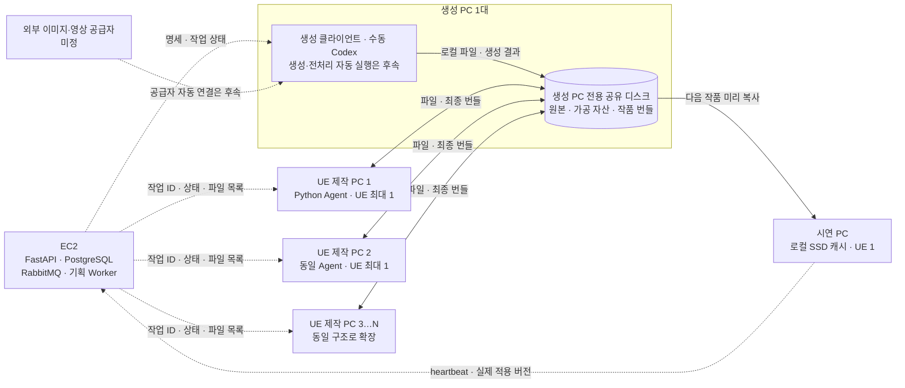

# 현장 공유 저장소와 작품 전송

> 이 문서의 SMB 배치는 별도 설계다. 현재 EC2 HTTP 연결은 [UE 실행 흐름](UE_RUNTIME_PIPELINE.md)의 EC2 원본 보관 정책을 따른다.

2026-10-21 배치 확정: **생성 PC 1대·UE 제작 PC 2대·시연 PC 1대, 총 4대**로 시작하며,
**공유 저장소는 생성 PC의 전용 디스크 데이터 폴더**에 둔다. 별도 공유 PC나 NAS는 추가하지 않는다.
UE 제작 노드는 같은 기능·작업함을 유지하며 N대로 확장한다. 생성·제작·시연 PC는 같은 유선망을 사용한다.
클라우드 저장소 사용이 어렵고, 예상 제작량은 하루 20작품이며 작품별 용량은 아직 측정하지 않았다.

## 초기 배치

생성 PC 한 대의 전용 디스크 데이터 폴더를 SMB 공유 저장소로 사용한다. 경로 예시는 `D:\RanelAssets`,
UE 제작/시연 PC의 접근 경로 예시는 `\\GENERATION-01\RanelAssets`다. **호스트명·경로는 예시이며 실제 공유는 생성하지 않았다.**
OS·프로젝트·UE 빌드 폴더 전체를 공유하지 않는다. 같은 폴더를 향하도록 각 Agent의 `ARTIFACT_ROOT`를 설정한다.
각 PC의 `NODE_CACHE` 또는 `SHOW_CACHE`는 공유 폴더와 다른 로컬 SSD 경로다.

| 장비 | 공유 저장소 접근 | 로컬 보관 |
|---|---|---|
| 생성 PC 1대 | 로컬 경로로 생성 결과 저장·조회. 공유 폴더 호스트 | 생성 작업·전용 공유 디스크 |
| UE 제작 PC 1·2 → N대 | 같은 생성 PC의 SMB 경로 읽기·필요한 번들 결과 쓰기 | 노드별 SSD 캐시·UE 조립 작업 폴더 |
| 시연 PC 1대 | 같은 SMB 경로를 읽기 권한으로 사용 | 현재·다음·마지막 정상 작품 SSD 캐시 |
| EC2 | 현장 SMB에 직접 접근하지 않음 | DB·작업 상태·파일 메타데이터 |

점선은 제어·메타데이터 또는 라벨에 표시한 후속 연결, 실선은 파일 전송이다.
이 도식은 배치 설계이며 실제 장비·UE 연결 완료를 뜻하지 않는다. 초기 UE 제작 PC는 1·2 두 대이고,
3…N은 증설 대상이다. 공유 폴더는 생성 PC 내부에 있으며 별도 물리 장비로 세지 않는다.
초기 총대수는 4대, UE 제작 N대 확장 시 생성·시연 각 1대를 포함해 N+2대다.

EC2는 사설망 공유 폴더를 직접 읽을 수 없다. 따라서 대용량 결과를 만드는 이미지·영상·전처리 실행부는
현장 저장소에 접근할 수 있는 장비에서 실행해야 한다. 초기 Compose의 Celery Worker는 진단·초안 기획만 처리하며,
외부 이미지·영상 작업을 EC2에서 실행한 뒤 NAS에 바로 쓴다고 가정하지 않는다.
현장 Worker를 연결할 때는 기존 Agent API 임대 방식을 확장한다. RabbitMQ를 인터넷에 공개하지 않는다.
Linux Celery를 현장에 꼭 배치할 경우에는 VPN·브로커 TLS·권한을 별도 설계한다.

## 파일과 상태의 분리

| 위치 | 보관 내용 |
|---|---|
| PostgreSQL | 작업·시도·노드·결과 상태, 파일 해시·크기·작품 ID·버전 |
| RabbitMQ | 작업 ID와 실행 요청. 이미지·영상 바이너리 없음 |
| 공유 폴더 `objects/<해시 앞 2자리>/<SHA-256>` | 생성 원본, 전처리 결과, 번들 구성 파일. 같은 바이트는 한 번만 저장 |
| 버전별 manifest | 상대 파일명, SHA-256, 크기, 작품 ID·버전, 공통 기능 카탈로그 버전 |
| 제작 노드 SSD | 임대받은 작업에 필요한 파일 캐시, 조립 작업 폴더 |
| 시연 노드 SSD | 현재·다음·마지막 정상 작품과 런타임 상태 |

UE 프로젝트 전체, `Intermediate`, `Saved`, Derived Data Cache를 매 작품마다 보내지 않는다.
공통 실행기와 기본 콘텐츠를 노드에 설치하고 작품별 이미지·영상·설정 파일을 전달한다.
사전 쿠킹 UE 콘텐츠는 `pre_cooked_ue`로 구분하며 마운트 방식이 정해지기 전에는 시연 Agent가 적용을 거부한다.
원본과 가공본의 해시가 다르면 별개 파일로 보관한다.

현재 구현은 파일 단위 재시도다. 중단된 파일은 다음 시도에 다시 복사하지만, 이미 완료된 해시 파일은 다시 전송하지 않는다.
대용량 영상 한 개의 부분 이어받기는 아직 구현하지 않았다. 실제 파일 크기를 보고 추가한다.
파일 캐시와 버전 폴더에 각각 복사본이 있어 로컬 SSD는 최악의 경우 필요한 파일 합계의 약 2배와 여유 공간이 필요하다.
네트워크 중복 전송은 줄이지만 모든 버전의 로컬 디스크 사용량까지 한 벌로 줄였다고 보지 않는다.

## 전송 지연을 전시에 노출하지 않는 방법

1. 시연 PC의 로컬 파일로 현재 작품을 실행한다. 공유 폴더에서 직접 영상 스트리밍하지 않는다.
2. 다음 작품은 별도 임시 폴더에 복사하고 SHA-256·크기·카탈로그 버전을 확인한다.
3. 파일 준비가 끝나면 `Staged`다. Runtime이 실제 준비를 마쳐야 `Ready`다.
4. Runtime이 실제 활성화한 버전이 일치할 때만 `Applied`를 보고한다.
5. 준비 실패·공유 PC 장애·중앙 통신 장애가 발생하면 현재 release와 로컬 작품을 유지한다.

현재 UE watcher는 새 `release.json`을 받은 뒤 내부에서 준비·자동 commit한다.
중앙 게시자가 Ready를 보고 별도 commit 명령을 보내는 최종 규약은 후속 구현이다.
프로세스 중단 후 UE 자동 재기동과 오프라인 기본 작품 복구도 실제 실행 파일을 받은 뒤 검증해야 한다.

## 하루 20작품의 용량과 전송 시간

아래는 작품당 **새로 추가되는 파일 합계**를 가정한 계산이다. 실제 작품 용량 예측이 아니다.
반복 재사용되는 파일은 한 번만 저장하지만 재생성·실패 결과·백업은 추가 용량을 쓴다.

| 작품당 신규 데이터 | 하루 20작품 | 30일 보관 |
|---:|---:|---:|
| 1 GB | 20 GB | 600 GB |
| 5 GB | 100 GB | 3 TB |
| 10 GB | 200 GB | 6 TB |
| 20 GB | 400 GB | 12 TB |

GB·TB는 십진 단위다. OS·캐시·백업·디스크 여유 공간은 표에 포함하지 않았다.
처음 3~5작품의 `total_bytes`, 실제 신규 해시 용량, 제작·복사 시간을 기록하고 용량을 결정한다.

`전송 시간(초) ≈ 파일 크기(GB) × 8,000 ÷ 실측 속도(Mbps)`다.
10 GB는 이론상 1 Gbps에서 약 80초, 100 Mbps에서 약 800초(13분 20초)다.
실제 속도는 HDD/SSD, NIC, 스위치, SMB 처리, 동시 전송에 따라 느려진다.
제작 PC 여러 대가 한 디스크를 동시에 읽고 쓰면 그 PC의 디스크와 네트워크가 병목이 된다.
먼저 유선 링크 속도와 실제 전송률을 측정하고, 부족할 때 SSD·2.5GbE·NAS를 검토한다.

## 운영 조건과 보관

- 공유 PC는 전시 중 켜 두고 절전·자동 재부팅 정책을 정한다. 꺼지면 신규 제작·다음 작품 배포가 멈춘다.
- 생성·제작 계정에는 필요한 쓰기 권한, 시연 계정에는 읽기 권한을 준다. 비밀번호는 코드·Git에 넣지 않는다.
- SMB는 현장 망에만 열고 인터넷에 445 포트를 공개하지 않는다. 게스트 공유나 SMB 서명 해제를 전제로 하지 않는다.
- 공유 PC가 단일 장애 지점이다. 현재 작품 로컬 캐시는 전시 지속용이지 원본 백업이 아니다.
- 승인 작품·재사용 자산은 별도 디스크/장비에 백업하고 복구 시험을 한다. 실제 백업 장비는 아직 미정이다.
- 보관 기간은 미정이다. 실패 임시 파일·비승인 후보·승인 작품을 구분해 정책을 정하고 자동 삭제를 연결한다.
- 현재·다음·마지막 정상 작품과 진행 중 작업이 참조하는 해시는 삭제하지 않는다. 이번 구현에는 자동 정리 기능이 없다.
- 승인된 버전은 수정하지 않고 새 버전을 만든다. manifest와 파일 해시가 다르면 적용하지 않는다.

Windows 공유의 암호화·서명 기능은 [Microsoft SMB 보안 문서](https://learn.microsoft.com/en-us/windows-server/storage/file-server/smb-security)를 따른다.
